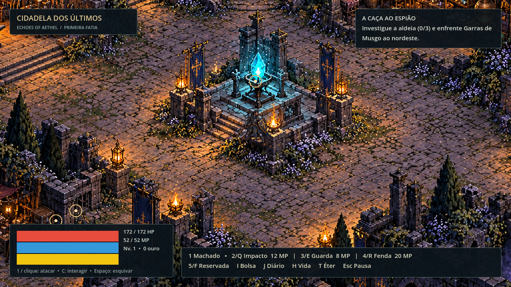
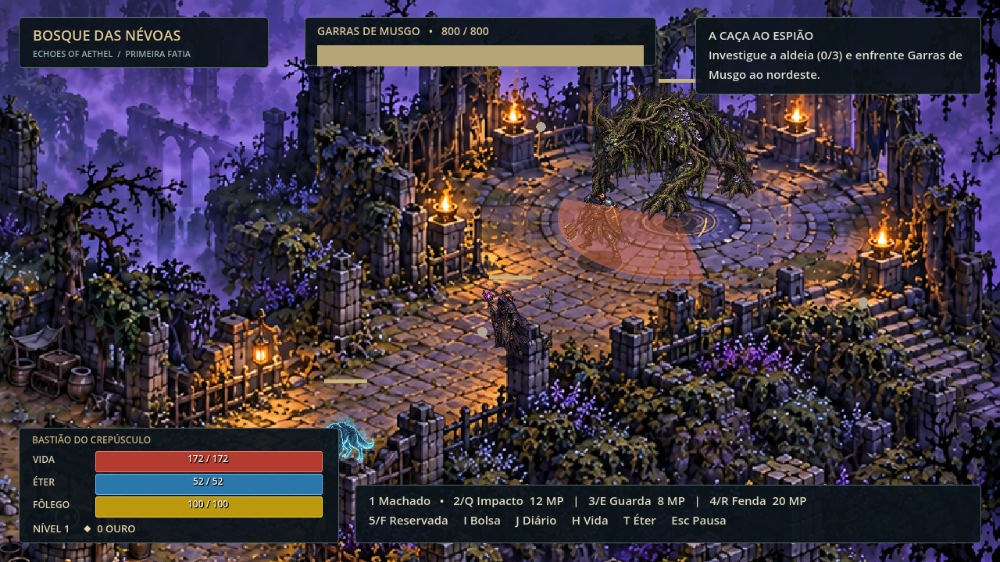
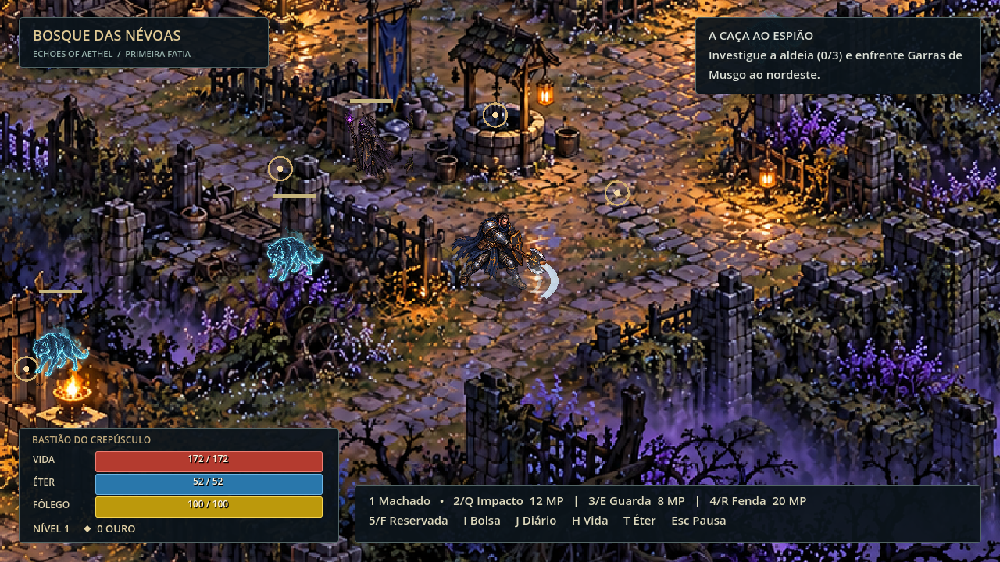
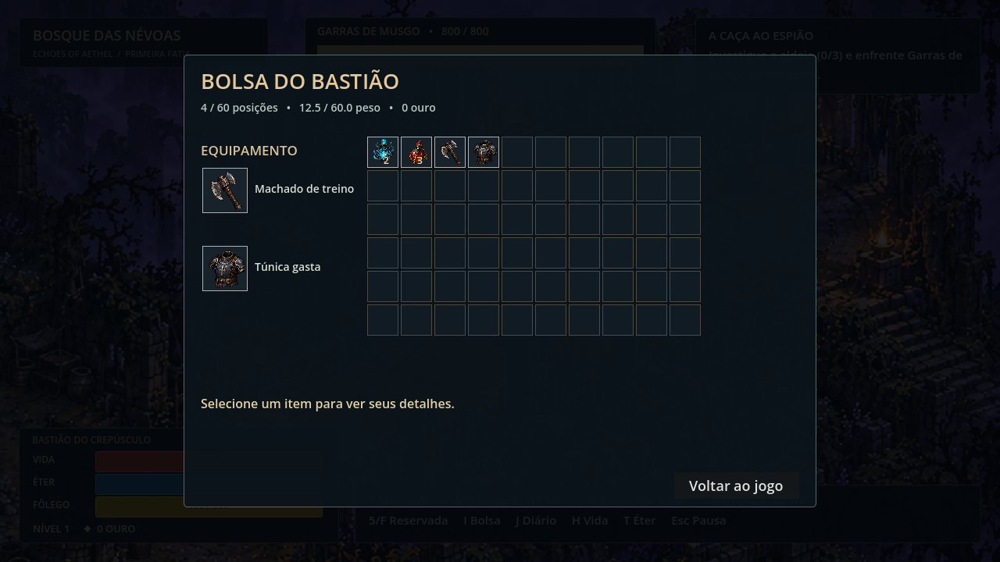
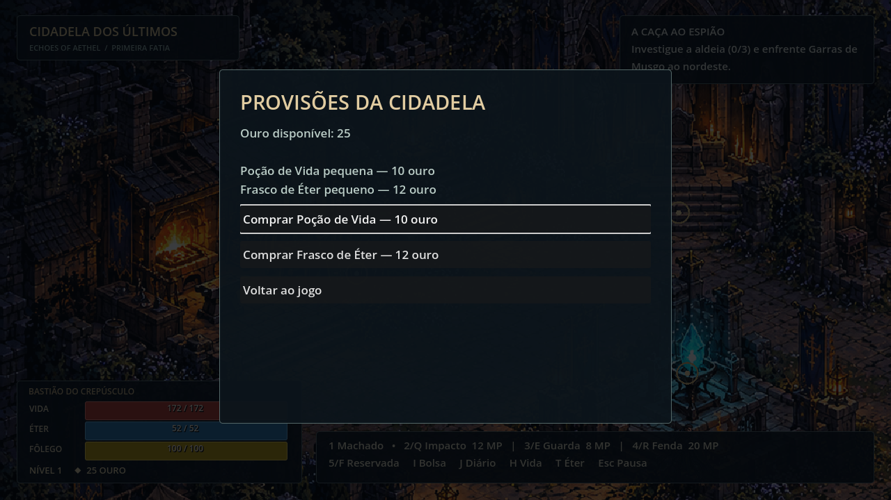

# Echoes of Aethel

**ARPG dark fantasy · um jogador · offline**

**Estado do projeto:** a versão jogável `0.2.0-dev` continua em **Godot 4.6 (2D)**. A produção futura está sendo preparada em **Unreal Engine 5.8 (3D isométrico)** no [PR #23](https://github.com/Sarhuman/Echoes-of-Aethel/pull/23). O projeto Unreal já compilou no Editor e passou um teste de atributos, mas ainda **não possui cena jogável 3D nem pacote Windows validado**. O trabalho atual é a pré-produção de conteúdo C0: cobrir os 12 mapas, cinco heróis, personagens, criaturas, narrativa e economia antes de iniciar a rota jogável Unreal.

> O caminho para o inferno está cheio de boas intenções.

O Bastião sai da Cidadela dos Últimos para investigar a aldeia no Bosque das Névoas. Esta versão **0.2.0-dev** contém uma primeira jornada jogável: explorar, lutar, coletar itens, derrotar Garras de Musgo, investigar três pistas, tomar uma decisão e voltar à Cidadela para observar a consequência.







Os cenários e sprites originais foram criados para esta versão tomando [esta imagem conceitual](docs/media/concepts/aethel-visual-target.png) como referência de atmosfera. A composição dos mapas privilegia caminhos legíveis, profundidade isométrica e ruínas góticas. A direção futura combina exploração e itemização inspiradas por **Diablo II: Resurrected** com combate e habilidades mais táticos inspirados por **Path of Exile 2**. A história, as regras e a identidade visual de Aethel são próprias. [Proveniência da arte](docs/media/runtime-art.md).

## Jogar a versão atual (Godot)

Instale **Godot 4.6 stable**, clone o repositório e execute:

```bash
git clone https://github.com/Sarhuman/Echoes-of-Aethel.git
cd Echoes-of-Aethel
godot --path client/godot
```

No editor, abra `client/godot/project.godot` e pressione **F5**. O projeto usa o renderer GL Compatibility. A campanha fica em JSON local com hash, backup e migração do formato v1 para v2. Ao continuar, o personagem retorna à Cidadela; flags, loot confirmado e decisões persistem.

| Ação | Teclas |
|---|---|
| Movimento | WASD ou setas |
| Machado | 1 ou clique esquerdo |
| Impacto do Baluarte | 2, Q ou clique direito |
| Guarda | 3 ou E |
| Fenda | 4 ou R |
| Esquiva | Espaço |
| Interagir | C |
| Bolsa de 60 posições | I |
| Diário | J |
| Poção de Vida / Frasco de Éter | H / T |
| Pausa, save e opções | Esc |

O slot 5/F está reservado. A Cidadela é uma área segura: lá, ataques e habilidades de combate ficam bloqueados e mostram um aviso. Atravesse o portão leste para lutar no Bosque. A bolsa mostra itens em grade, equipamento, peso, capacidade e ações de usar, equipar ou descartar. Excedentes de recompensas aguardam retirada na Cidadela.

Lyra e Sera atendem na Cidadela: aproxime-se e pressione **C** para comprar Poção de Vida (10 ouro) ou Frasco de Éter (12 ouro). Ouro vem dos encontros; compras recusadas por falta de ouro ou espaço não gastam nada. O HUD mostra Vida, Éter e Fôlego em medidores com valores numéricos.





## Conteúdo e limites

A jornada traz Lobo Etéreo, Cultista Cego e o **subchefe** Garras de Musgo, com ataques antecipados, progressão de atributos, loot e XP. A quest **A Caça ao Espião** permite julgar suspeitos ou escoltar moradores; a escolha altera falas e detalhes do hub. A Cidadela é área segura e checkpoint único.

Esta é a primeira fatia da campanha. Os quatro atos, as outras quatro classes e os demais mapas descritos no GDD continuam planejados. Há animações de caminhada e golpe; outros movimentos, a mixagem e o equilíbrio ainda precisam de playtest. Os valores de balanceamento estão marcados como experimentais em [experimental-values.md](docs/engineering/experimental-values.md).

## Próxima produção (Unreal)

O [PR #23](https://github.com/Sarhuman/Echoes-of-Aethel/pull/23) reúne o projeto mínimo Unreal, o atlas dos 12 mapas, o índice de heróis e bestiário, as decisões de direção e contratos iniciais de save, loot, grade e baú. As 18 pranchas de personagens são **conceitos gerados, ainda não modelos 3D aprovados**. Os documentos e o build básico são progresso de pré-produção; não equivalem a mapas, inimigos ou comércio implementados no Unreal.

A sequência acordada é: concluir e revisar o conteúdo C0; medir câmera, escala e custo de arte; só então produzir e validar a primeira rota 3D. O cliente Godot permanece como referência de comportamento e regressão durante a transição. A cobertura de 22% citada na planilha de planejamento é uma **estimativa**, não porcentagem de conclusão do jogo Unreal.

## Verificar e exportar

Da raiz do repositório:

```bash
bash tools/run_tests.sh
```

No Windows, também é possível executar `tools/run_tests.ps1 -Godot <caminho-para-godot.exe>`. A validação registrada para a versão Godot aprovou **16 suítes e 308 verificações** em Godot 4.6, incluindo a arena técnica anterior, um fluxo de integração da jornada e compras. A exportação Windows usa `tools/export_windows.ps1` com os templates oficiais 4.6 instalados em `.godot-tools/`. O workflow de CI importa, testa e exporta automaticamente em pushes e PRs. Capturas de QA exigem `-- --test-harness` para isolar o save.

As capturas acima são do executável Godot rodando localmente. Elas verificam renderização, mas não substituem um playtest humano de navegação, dificuldade e desempenho em diferentes PCs.

A arena experimental anterior continua em `res://playtest/arena.tscn` para comparação técnica; a cena inicial é a campanha jogável.

## Documentação

[Pré-produção Unreal no PR #23](https://github.com/Sarhuman/Echoes-of-Aethel/pull/23) · [Escopo](docs/engineering/project-scope.md) · [Decisões da primeira fatia](docs/engineering/decisions-first-slice.md) · [Estrutura](docs/engineering/project-structure.md) · [Cartões T00–T12](docs/engineering/tasks/README.md) · [GDD](docs/GDD/README.md) · [Proposta visual](docs/design/visual-proposal.md) · [Guia para agentes](AGENTS.md) · [Changelog](CHANGELOG.md)

Nenhuma licença geral foi definida pelo proprietário do projeto; o repositório não concede licença pública automaticamente.
