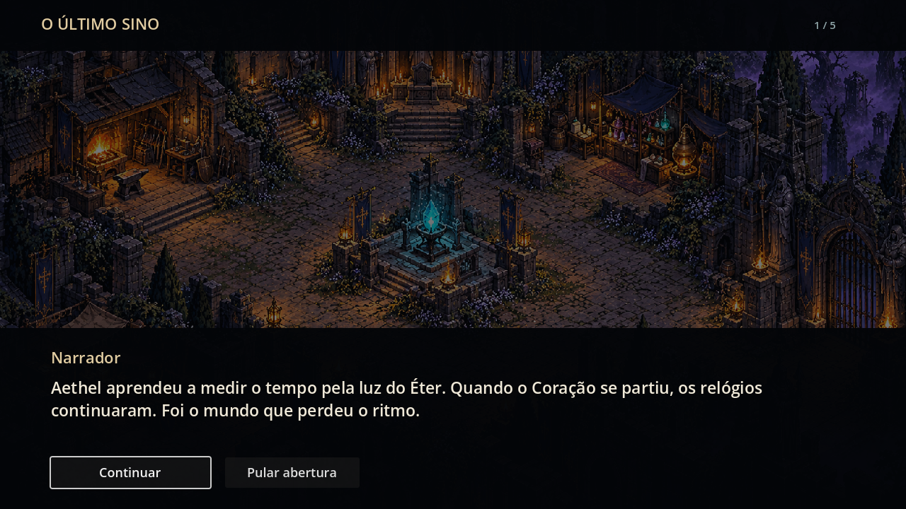

# Echoes of Aethel

**ARPG 2D dark fantasy · Godot 4.6 · um jogador · offline**

> O caminho para o inferno está cheio de boas intenções.

O Bastião sai da Cidadela dos Últimos para investigar a aldeia no Bosque das Névoas. Esta versão **0.2.0-dev** contém uma primeira jornada jogável: assistir ou pular a abertura, falar com o conselho, explorar, lutar, coletar itens, derrotar Garras de Musgo, investigar três pistas, tomar uma decisão e voltar à Cidadela para observar a consequência. Bram, Irian, Lyra, Maera e Sera aparecem na Cidadela e mantêm seus pontos de interação.




Os cenários e sprites originais foram criados para esta versão tomando [esta imagem conceitual](docs/media/concepts/aethel-visual-target.png) como referência de atmosfera. A composição dos mapas privilegia caminhos legíveis, profundidade isométrica e ruínas góticas. **Path of Exile 2** é a referência principal para a próxima etapa de combate e habilidades; o conteúdo e as regras de Aethel permanecem próprios. [Proveniência da arte](docs/media/runtime-art.md).

## Jogar

Instale **Godot 4.6 stable**, clone o repositório e execute:

```bash
git clone https://github.com/Sarhuman/Echoes-of-Aethel.git
cd Echoes-of-Aethel
godot --path client/godot
```

No editor, abra `client/godot/project.godot` e pressione **F5**. O projeto usa o renderer GL Compatibility. A campanha fica em JSON local com hash, backup e migração do formato v1 para v2. Ao continuar, o personagem retorna à Cidadela; flags, loot confirmado e decisões persistem.

| Ação | Teclas |
|---|---|
| Movimento | WASD ou setas |
| Machado | 1 ou clique esquerdo |
| Impacto do Baluarte | 2, Q ou clique direito |
| Guarda | 3 ou E |
| Fenda | 4 ou R |
| Esquiva | Espaço |
| Interagir | C |
| Bolsa de 60 posições | I |
| Diário | J |
| Poção de Vida / Frasco de Éter | H / T |
| Pausa, save e opções | Esc |

O slot 5/F está reservado. A Cidadela é uma área segura: lá, ataques e habilidades de combate ficam bloqueados e mostram um aviso. Atravesse o portão leste para lutar no Bosque. A bolsa mostra itens em grade, equipamento, peso, capacidade e ações de usar, equipar ou descartar. Excedentes de recompensas aguardam retirada na Cidadela.

Uma campanha nova começa com uma curta cena ilustrada baseada no prólogo do GDD, narrada em português pela voz do sistema quando disponível, com trilha épica original que baixa de volume durante as falas. Ela pode ser pulada sem perder equipamento ou objetivos. A primeira conversa com Irian apresenta o conselho; depois, o objetivo aponta para o Bosque. A opção **Som** também silencia a narração. Golpes confirmados recebem um tremor breve de câmera, desativado em **Efeitos reduzidos**.

Lyra e Sera atendem na Cidadela: aproxime-se e pressione **C** para comprar provisões, antídoto ou equipamento. Sera também compra materiais e peças não equipadas. Ouro vem dos encontros; transações recusadas não alteram a bolsa. O HUD mostra Vida, Éter e Fôlego em medidores com valores numéricos. A trilha original alterna entre Cidadela, Bosque e combate, com efeitos para golpes e habilidades; a opção **Som** silencia tudo. [Proveniência e geração do áudio](docs/media/runtime-audio.md).


## Conteúdo e limites

A jornada traz Lobo Etéreo, Cultista Cego e Garras de Musgo com ataques antecipados, boss com três padrões, progressão de atributos, loot e XP. A quest **A Caça ao Espião** permite julgar suspeitos ou escoltar moradores; a escolha altera falas e detalhes do hub. Após a volta, fale com **Irian, líder do conselho, junto ao cristal**; a conversa encerra o objetivo e fica salva. A Cidadela é área segura e checkpoint único. Corpos de inimigos derrotados somem; o jogador atravessa inimigos sem ser preso contra a parede, e a borda do abismo do Bosque bloqueia a passagem. Acertos exibem dano vermelho; golpes que não encontram alvo exibem “MISS” azul. **3/E é Guarda:** reduz dano frontal enquanto o escudo aparece, sem atacar.

Esta é a primeira fatia da campanha. Os quatro atos, as outras quatro classes e os demais mapas descritos no GDD continuam planejados; **somente o Bastião é jogável nesta versão**. Há animações de caminhada e golpe do Bastião e quatro poses de caminhada do Lobo, Cultista e Garras de Musgo; outros movimentos, a mixagem e o equilíbrio ainda precisam de playtest. Os valores de balanceamento estão marcados como experimentais em [experimental-values.md](docs/engineering/experimental-values.md).

## Verificar e exportar

Da raiz do repositório:

```bash
bash tools/run_tests.sh
```

No Windows, também é possível executar `tools/run_tests.ps1 -Godot <caminho-para-godot.exe>`. A validação local passou em **20 suítes / 409 verificações**, incluindo combate, mapa, áudio, comércio, save e o fluxo de integração da jornada. A exportação Windows usa `tools/export_windows.ps1` com os templates oficiais 4.6 instalados em `.godot-tools/`; o executável iniciou por 120 quadros no teste automatizado. O workflow de CI importa, testa e exporta automaticamente em pushes e PRs. Capturas de QA exigem `-- --test-harness` para isolar o save.

As capturas acima são do executável Godot rodando localmente. Elas verificam renderização, mas não substituem um playtest humano de navegação, dificuldade e desempenho em diferentes PCs.

A arena experimental anterior continua em `res://playtest/arena.tscn` para comparação técnica; a cena inicial é a campanha jogável.

## Documentação

[Escopo](docs/engineering/project-scope.md) · [Decisões da primeira fatia](docs/engineering/decisions-first-slice.md) · [Estrutura](docs/engineering/project-structure.md) · [Cartões T00–T12](docs/engineering/tasks/README.md) · [GDD](docs/GDD/README.md) · [Proposta visual](docs/design/visual-proposal.md) · [Guia para agentes](AGENTS.md) · [Changelog](CHANGELOG.md)

Nenhuma licença geral foi definida pelo proprietário do projeto; o repositório não concede licença pública automaticamente.
