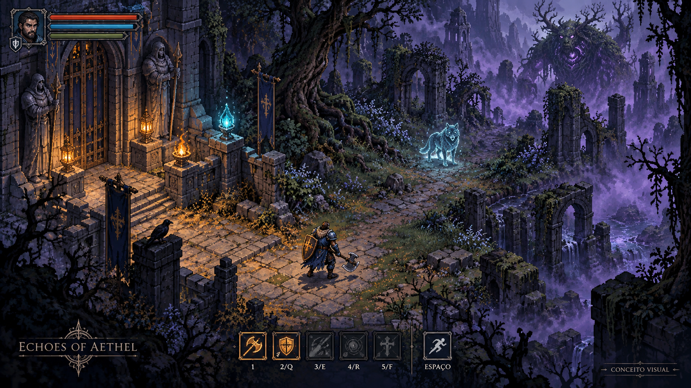
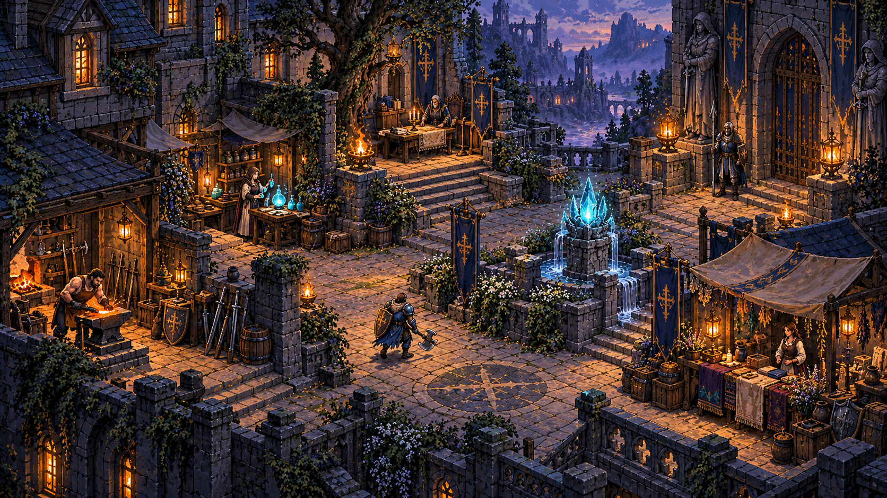
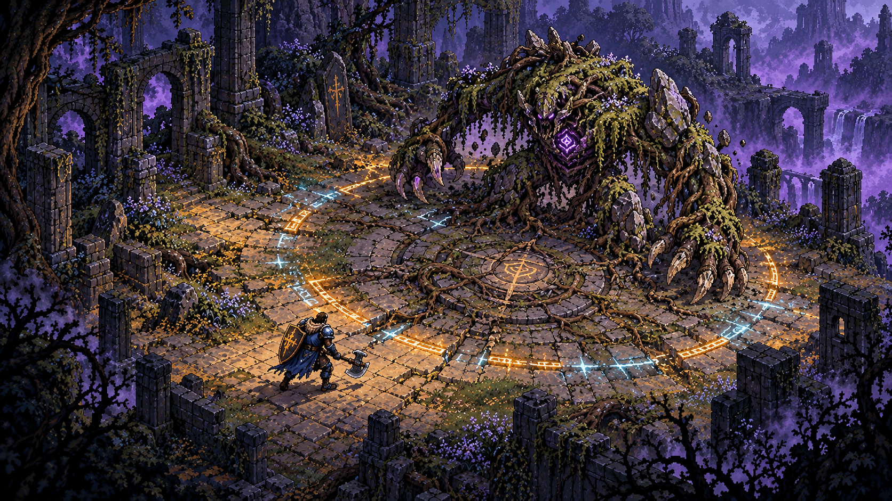

# Echoes of Aethel

**Dark fantasy · ARPG 2D · Pixel art · Single-player offline**

> O caminho para o inferno está cheio de boas intenções.



*Arte conceitual gerada por IA para orientar a produção. As imagens desta página não são capturas da versão executável nem sprites prontos. O jogo atual abre uma arena de playtest com formas provisórias.*

[Escopo do projeto](docs/engineering/project-scope.md) · [Proposta visual](docs/design/visual-proposal.md) · [GDD](docs/GDD/README.md) · [Histórico](CHANGELOG.md) · [Versões](docs/engineering/versions.md)

## O jogo

Um mundo de magia decadente, ferido pela ruptura do Coração de Éter. Na **Cidadela dos Últimos**, um fragmento ainda puro preserva um refúgio. Além dos portões, a Bruma transforma criaturas, ruínas e pessoas.

O Bastião atravessa o Bosque das Névoas em busca de respostas. Combate, exploração e escolhas se encontram: salvar alguém pode desencadear outra tragédia, e as consequências reaparecem no mundo. A segurança do hub e os serviços essenciais permanecem disponíveis.

**Loop da primeira fatia:** preparar-se na Cidadela → explorar o Bosque → lutar → coletar → decidir o destino do espião → retornar e observar a consequência.

## Versão e estado real

| Item | Estado |
|---|---|
| Projeto | **0.2.0-dev — arena de playtest / pré-alpha** |
| Engine validada | **Godot 4.6 stable**, GDScript, renderer GL Compatibility |
| Plataforma inicial | Windows; export executável ainda pendente |
| Testes executados | **144 verificações aprovadas**, Godot 4.6 Linux headless |
| Save | Envelope `schema_version = 1`; conteúdo `world-save-1` |
| Campanha | Documentada; ainda não jogável |
| Download / release | Sem pacote Windows, tag ou release publicada |

A versão está em [VERSION](VERSION) e em `config/version` do projeto. O número do save tem ciclo independente. As verificações foram executadas localmente; não representam CI, benchmark ou playtest visual.

## Galeria conceitual

### Cidadela dos Últimos — abrigo e preparação



*Proposta de ambiente seguro: pedra azul, luz âmbar e Éter ciano. Bram, Lyra, Irian, Maera e Sera mantêm suas funções. Este mapa ainda precisa ser produzido na engine.*

### Bosque das Névoas — Garras de Musgo



*Proposta de arena e antecipação visual. Boss, onda de choque e composição final permanecem em desenvolvimento; a imagem não comprova mecânicas implementadas.*

Origem, integridade e uso dos três arquivos: [manifesto das imagens](docs/media/concepts/README.md).

## O que funciona agora

- Arena com três encontros, vitória/derrota, pausa e reinício; recuperação entre encontros.
- Lobo e Cultista experimentais, navegação estática A*, memória limitada e avisos de ataque.
- Movimento com projeção 2:1, colisão com parede, dash, stamina e 120 ms de invulnerabilidade.
- Ataques básico/pesado com MP, direção fixa, fases temporais e um acerto por alvo por golpe.
- Recusa de comandos inválidos e prevenção de débito/execução duplicados.
- Inimigo com FSM, alcance, percepção e verificação de parede.
- HP, morte, bloqueio de dano na Cidadela e núcleo de persistência de mundo com backup.
- HUD técnico, indicador do golpe e apresentação Base/Melhorada com efeitos reduzidos.

A detecção de golpes usa amostragem física discreta. Não há reconstrução histórica de trajetórias nem garantia de colisão contínua para movimento rápido. Parâmetros de dano, MP e alcance são experimentais. [Contratos e limites do combate](docs/engineering/offline-combat.md).

## Jogar o playtest

1. Instale **Godot 4.6 stable**.
2. Clone este repositório e importe `client/godot/project.godot` no Project Manager.
3. Abra o projeto e pressione **F5**.
4. Clique em **Iniciar treino** ou pressione **Enter**. Vença três encontros.

[Guia do playtest](docs/engineering/playtest.md): instalação, objetivo, controles e roteiro de avaliação. A cena técnica anterior continua em `res://scenes/test_scene.tscn` (F6 no editor executa a cena aberta).

```bash
git clone https://github.com/Sarhuman/Echoes-of-Aethel.git
cd Echoes-of-Aethel
godot --path client/godot
```

O repositório pode exigir acesso autenticado. Não é necessário backend ou conta dentro do jogo para o playtest. Ainda não há instalador nem executável Windows distribuído.

### Controles aprovados

| Ação | Teclas | Na cena atual |
|---|---|---|
| Movimento | **WASD** ou **setas** | Implementado |
| Ataque básico | **1** | Implementado |
| Habilidade 1 | **2** ou **Q** | Pesado experimental |
| Habilidade 2 | **3** ou **E** | Reservada; aviso de indisponibilidade |
| Habilidade 3 | **4** ou **R** | Reservada; aviso de indisponibilidade |
| Habilidade 4 | **5** ou **F** | Reservada; aviso de indisponibilidade |
| Dash | **Espaço** | Implementado |
| Reiniciar tentativa | **F6** | Volta à preparação; não é checkpoint |
| Iniciar / próximo encontro | **Enter** | Também disponível por botão |
| Pausar / continuar | **Esc** | Congela a arena |
| Alternar apresentação | **F8** | Apenas na cena técnica anterior |
| Reduzir efeitos | **F9** | Apenas na cena técnica anterior |

Números da fileira superior. Aliases acionam a mesma habilidade; W permanece exclusivo de movimento. Habilidades reservadas não gastam recursos. Os ícones da arte conceitual não definem o loadout final.

### Verificar a base

Executar da raiz, com Godot 4.6 disponível como `godot`:

```bash
godot --headless --editor --path client/godot --quit
godot --headless --path client/godot --script res://tests/test_save_system.gd
godot --headless --path client/godot --script res://tests/test_enemy_fsm.gd
godot --headless --path client/godot --script res://tests/test_player.gd
godot --headless --path client/godot --script res://tests/test_presentation.gd
godot --headless --path client/godot --script res://tests/test_combat.gd
godot --headless --path client/godot --script res://tests/test_arena.gd
```

As suítes de persistência usam e apagam dados do harness; não executar sobre saves de produção ou concorrentemente sobre o mesmo slot. Distribuição: save 27, FSM 25, Player 19, apresentação 13, combate 41 e arena 19.

## O que falta para a primeira fatia jogável

| Prioridade | Entrega pendente | Aceite |
|---|---|---|
| 1 | Guarda, habilidades restantes e regras de interrupção | Arena com todas as ações utilizáveis e custos validados |
| 2 | Cidadela/Bosque conectados e morte/checkpoint | Sair, lutar, morrer e recuperar sem perder decisões |
| 3 | Finalizar Lobo/Cultista e implementar Garras de Musgo | Encontros próprios, antecipações e esquiva verificadas |
| 4 | Inventário, loot/XP e migração do save | Recompensa confirmada sem perda/duplicação, inclusive bolsa cheia |
| 5 | A Caça ao Espião e consequência no hub | Executar ou poupar; salvar/reabrir preserva a rota escolhida |
| 6 | Arte, áudio, menus e acessibilidade | Leitura clara em movimento e com efeitos reduzidos |
| 7 | CI, export e playtest Windows | Build reproduzível e loop completo fora do editor |

Também faltam uma política de licença do projeto e a revisão de proveniência dos futuros assets externos. Nenhuma licença de terceiros foi atribuída automaticamente às imagens desta página.

## Visão de expansão

A campanha completa prevê **cinco classes, quatro atos e doze mapas**. Bastião é a primeira classe; Tecelão de Runas, Sentinela das Sombras, Invocadora de Espinhos e Inquisidor da Chama Sagrada entram em etapas posteriores.

O caminho passa pelo Bosque, Pântano e Portal, segue por desertos, criptas, máquinas e jardins suspensos, até Vael no Pináculo Celestial. Detalhes e spoilers estão no GDD. Multiplayer, outras plataformas, crafting avançado e Eclipse ficam fora da primeira fatia. A Alpha poderá acrescentar conta e saves em nuvem; não há backend implementado neste repositório.

## Arquitetura e referências

`AttackDefinition` guarda conteúdo; `CombatService` calcula; `AttackController` confirma execução; atores adaptam input/física; apresentação reage a fatos confirmados. Save, quest e economia mantêm autoridade no domínio.

| Referência | Uso no projeto |
|---|---|
| [Godot Tactical RPG](https://github.com/ramaureirac/godot-tactical-rpg) | Inspiração de composição ator/modelo/serviço; implementação própria para tempo real 2D |
| [Maaack Game Template](https://github.com/Maaack/Godot-Game-Template) | Candidato para menus/carregamento; ainda não instalado |
| [Dialogic](https://github.com/dialogic-godot/dialogic) | Candidato para apresentação de diálogos; ainda não instalado |

Não há versões instaladas desses plugins para atualizar. A versão será fixada quando houver adoção. Saves Resource externos do template não substituem nosso JSON. Ver [versões e compatibilidade](docs/engineering/versions.md).

## Documentação e histórico

- [Escopo, fronteiras e critérios de aceite](docs/engineering/project-scope.md)
- [Direção visual e pacote de produção](docs/design/visual-proposal.md)
- [Índice do GDD](docs/GDD/README.md)
- [Decisões de produção](docs/engineering/production-decisions.md)
- [Roadmap](docs/engineering/roadmap.md)
- [Combate offline](docs/engineering/offline-combat.md)
- [Fluxo de contribuição por PR](docs/engineering/github-workflow.md)
- [Changelog](CHANGELOG.md)

Os PRs #1–#18 foram integrados à `main` em ordem de dependência. Documentos de sprint preservam o histórico; o escopo atual e as decisões posteriores indicam o que continua vigente.
