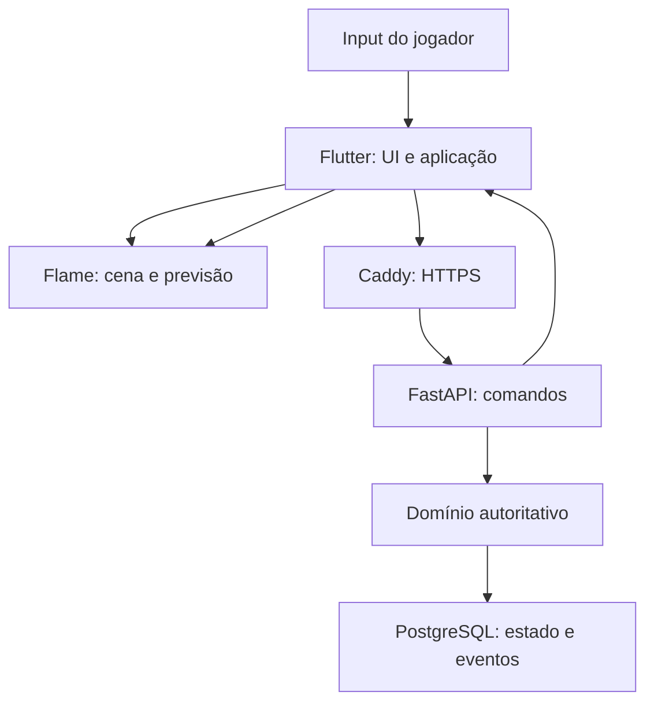

# Sprint 2 — Arquitetura técnica e infraestrutura

**Projeto:** Echoes of Aethel · **Versão:** 1.0 · **Estado:** arquitetura definida; implementação, deploy e benchmarks pendentes.

Stack escolhida nesta Sprint: Dart/Flutter/Flame no cliente, Python/FastAPI no servidor e PostgreSQL. Esta decisão substitui a etapa anterior de seleção de engine. O protótipo offline continua como primeiro marco; progressão online terá autoridade do servidor e não aceitará importação irrestrita de saves locais.

> **Revisão da Sprint 6:** o cliente passa a Godot/GDScript conforme [módulo 06](06_arquitetura_software.md). Flutter/Flame e referências de build/renderização abaixo registram a proposta anterior; API, banco, segurança e Compose continuam referência. Export web e renderer devem ser validados no pipeline Godot.

## 1. Stack tecnológico

| Camada | Tecnologia | Responsabilidade |
|---|---|---|
| Cliente | Dart + Flutter | Shell, autenticação, menus, inventário, acessibilidade e navegação |
| Jogo | Flame | Cena 2D, componentes, input, animação, colisão visual e previsão local |
| Renderização | Canvas do Flutter e backend gráfico da plataforma | Pixel art, composição paperdoll, câmera, luz e VFX |
| API | Python + FastAPI + Uvicorn | Contratos REST, autorização, comandos e respostas versionadas |
| Persistência | SQLAlchemy assíncrono + driver asyncpg | Repositórios, transações, controle de concorrência e pool |
| Migrações | Alembic | Evolução do schema, índices, constraints e dados de referência |
| Dados | PostgreSQL + JSONB | Contas, personagens, inventários, encontros e histórico de decisões |
| Deploy | Docker Compose + Caddy | Serviços, redes privadas, HTTPS e arquivos estáticos do cliente web |
| Proxy alternativo | Nginx | Substitui Caddy quando houver administração de TLS própria; não operar ambos sem necessidade |

Flame desenha por APIs de Canvas; não escolhe diretamente Vulkan/OpenGL. Flutter abstrai o backend, que depende da plataforma: Impeller em plataformas compatíveis e renderizadores web próprios. Não prometer Vulkan no navegador. **60 FPS é meta de cliente**, equivalente a orçamento de aproximadamente 16,67 ms/frame, a medir em build release no equipamento-alvo.

Versões exatas de Flutter/Dart, Flame, Python e bibliotecas serão fixadas após teste de compatibilidade; lockfiles do app e backend entram no Git. Imagens de produção serão fixadas por versão e digest, nunca `latest`. PostgreSQL 17 é a linha usada no exemplo, sem obrigação de atualização automática de major.

## 2. Limites da arquitetura



| Módulo | Limite |
|---|---|
| Domínio Dart | Regras locais offline, fórmulas e previsão; sem dependência de widgets/cenas |
| Aplicação cliente | Casos de uso, fila de comandos, adapters offline/online e reconciliação |
| Apresentação | Flame e widgets; não concede XP, loot ou fragmentos online |
| Domínio Python | Regras canônicas online, validação de combate e progressão |
| Aplicação servidor | Autorização, idempotência, transações e emissão de eventos |
| Infraestrutura servidor | SQLAlchemy, configuração, relógio e RNG injetáveis |
| Conteúdo | Catálogos versionados de classes, mapas, itens, habilidades e quests |

Estrutura proposta: `client/lib/{domain,application,infrastructure,presentation}`, `backend/app/{domain,application,infrastructure,api}`, `content/`, `infra/`, `tests/`. São diretórios planejados, não código já presente.

Fórmulas da Sprint 1 terão vetores de teste compartilhados em JSON: entradas e resultados esperados, sem executar código vindo do catálogo. Servidor e cliente devem coincidir em inteiros/arredondamento. Divergências de versão bloqueiam comandos online com erro recuperável; cliente recarrega catálogo compatível.

### 2.1 Offline e online

- **Offline:** save local versionado; jogador pode modificar seus próprios arquivos. Toda campanha pode ser validada localmente, sem promessa de anticheat.
- **Online:** conta, personagem e inventário têm autoridade no servidor; save local é cache. Estado econômico não é mesclado a partir de um snapshot do dispositivo.
- Personagem offline não vira personagem competitivo por upload. Migração futura exigiria uma política específica; fora desta Sprint.
- A presença de backend não implica multiplayer cooperativo nesta entrega. Campanha online inicialmente continua single-player.

## 3. Paperdoll 2D — confecção e personalização

### 3.1 Contrato de assets

Sprites jogáveis canônicos usam **32×32**. O renderer aceita **48×48** em criaturas e módulos que exigirem uma silhueta maior; uma família de paperdoll usa sempre a mesma célula, origem, direções e animação. Não misturar corpo 32×32 com armadura 48×48 sem conversão explícita no pipeline.

Atlas por família contém quatro direções, estado, frame e âncora dos pés. Metadados: `appearance_family`, `cell_size`, `anchor`, `state`, `direction`, `frame_count`, `durations_ms`, `asset_id` e `content_version`. Frames de equipamento acompanham o corpo; camada sem animação compatível usa fallback visual aprovado, sem quebrar o estado do jogo.

| Ordem | Camada | Regra |
|---:|---|---|
| 1 | Corpo base | Silhueta, pose e origem nos pés |
| 2 | Pele / cabelo | Paleta pessoal; cabelo ocultável por elmo |
| 3 | Armadura | Peitoral, luvas e botas compatíveis com a família |
| 4 | Elmo | Máscara de cobertura do cabelo/rosto |
| 5 | Arma / escudo | Âncoras por direção/frame; mãos e oclusão consistentes |
| 6 | Aura / VFX | Efeitos independentes; nunca alteram hitbox |

Essa é a ordem lógica. Renderização dorsal pode colocar arma/escudo atrás do corpo com subcamadas definidas por direção. Objetos do mundo usam ordenação pelo ponto dos pés; auras não mudam prioridade de colisão. Mãos, cabelo e acessórios assimétricos precisam de atlas próprio, sem espelhamento incorreto.

### 3.2 Troca dinâmica de equipamento

1. UI envia intenção de equipar `item_instance_id` e slot, com versão esperada do personagem.
2. Servidor verifica propriedade, classe, slot, requisitos e inventário; modifica equipamento e estatísticas na mesma transação.
3. Resposta traz nova versão, estatísticas e `appearance_manifest` com IDs de assets permitidos. Cliente não fornece URLs arbitrárias de sprites.
4. Cliente pré-carrega módulos faltantes e troca o conjunto inteiro no próximo frame. Mantém aparência anterior enquanto carrega; na falha usa fallback e permite retry.
5. Evento de equipamento não reinicia ataque/cooldown. Prévia cosmética no menu pode ser local, mas status de combate permanece o confirmado.

No offline, adapter local realiza as mesmas validações funcionais. Cache por chave família/equipamento/estado/direção, carregamento por zona e descarte com limites medidos. Evitar gerar imagem composta a cada frame; medir draw calls antes de introduzir cache de composições.

## 4. API e comunicação

### 4.1 REST versionado

Prefixo `/api/v1`; JSON UTF-8; timestamps UTC; UUIDs para entidades; IDs estáveis para conteúdo. Rotas abaixo são **contratos propostos**, ainda não implementados.

| Método / rota | Entrada principal | Resultado / restrição |
|---|---|---|
| POST `/auth/register` | E-mail, senha | Cria conta; rate limit e validação |
| POST `/auth/login` | Credenciais | Access token curto e sessão refresh rotativa |
| POST `/auth/refresh` | Credencial refresh | Rotação; reutilização revoga família de sessão |
| POST `/auth/logout` | Sessão atual | Revoga refresh; tokens de acesso têm expiração curta |
| GET `/auth/me` | Autenticação | Usuário e sessão autorizada |
| POST `/characters` | Nome, `class_id`, cosméticos permitidos | Personagem nível 1 com base da Sprint 1; sem atributos enviados pelo cliente |
| GET `/characters/{id}` | Propriedade | Snapshot, versão, inventário e checkpoint |
| PATCH `/characters/{id}/state` | `expected_version`, preferências/cosméticos permitidos | Save parcial autorizado; não aceita HP, XP, ouro, inventário ou corrupção arbitrários |
| POST `/characters/{id}/purchases` | Oferta do catálogo, quantidade e versão esperada | Compra no hub: débito de ouro e itens atômicos |
| POST `/characters/{id}/consumables` | Instância/stack e action_id | Uso como comando de simulação; recurso/cooldown autoritativos |
| POST `/characters/{id}/equipment` | Instância, slot, versão esperada | Equipamento, atributos e aparência recalculados |
| POST `/characters/{id}/attribute-allocations` | Distribuição de pontos disponíveis | Valida total, limites e progressão |
| POST `/characters/{id}/skill-unlocks` | Nó e versão esperada | Valida nível, pontos e pré-requisitos |
| POST `/characters/{id}/quests/{quest_id}/choices` | `option_id`, versão esperada | Decisão única, efeitos, eventos pendentes e nova versão |
| POST `/characters/{id}/encounters` | Zona/encontro permitido | Abre instância com conteúdo e estado autoritativos |
| POST `/encounters/{id}/commands` | Sequência de intenções, versão, action IDs | Avança simulação validada e retorna estado/eventos |
| GET `/encounters/{id}` | Propriedade | Reconciliação e resultado já confirmado |
| GET `/health/live` | Sem credencial | Processo ativo; sem dados sensíveis |
| GET `/health/ready` | Rede operacional | Banco/schema compatíveis; 503 se indisponível |

Todas as mutações de domínio usam `Idempotency-Key` UUID, vinculado a usuário, rota e hash canônico do payload. Repetição igual retorna resultado original; chave com outro payload gera 409. Versão desatualizada gera 409 `STATE_VERSION_CONFLICT`; decisão diferente já confirmada gera 409 `QUEST_ALREADY_DECIDED`. Ownership incorreto não revela dados de outro jogador.

Envelope de erro: `code`, `message`, `request_id`, `details` públicos limitados. Nunca retornar stack trace, SQL, segredo ou futuros eventos narrativos. DTOs tipados, campos extras recusados, limites de strings/listas/payload e validação semântica no servidor.

### 4.2 Autoridade de combate, loot e XP

Não existe endpoint que aceite “matei o boss, dê XP”. Cliente envia **intenções**, não dano, resultado, duração confiável ou drop. Servidor cria encontro, valida posição/colisão, habilidade, cooldown, MP, alvo e estado vivo; executa a IA e determina vitória. Tempo de cliente não acelera simulação: avanço é limitado pelo relógio do servidor e orçamento de passos. Seed econômica/RNG de loot não é exposta ao cliente.

REST em lotes é suficiente para a primeira integração de encontros pequenos: simulação fixa proposta de 20 Hz e comandos agrupados, com previsão/interpolação no cliente a 60 FPS. Frequência, tamanho de lote e timeout exigem teste de latência; não são promessa de experiência competitiva. Cadência de comandos é limitada e múltiplas requisições simultâneas do mesmo encontro são serializadas.

Cada lote aplica estado do encontro, eventos, XP e loot quando a vitória ocorre, sob lock e transação. Índice único em `(encounter_id, reward_kind)` impede recompensa duplicada; recompensa de campanha possui chave própria `(character_id, campaign_id, reward_id)`. Cliente só exibe o resultado. Retry, queda de conexão e troca de worker leem o estado persistido, nunca ressorteiam loot.

Dados duráveis de encontro e decisões ficam no PostgreSQL, não em variáveis globais de Uvicorn. Locks curtos por encontro e `AsyncSession` própria por unidade de trabalho; nunca compartilhar uma sessão em tarefas paralelas. Computação CPU-bound tem orçamento e não bloqueia indefinidamente o event loop. Se o custo de simulação crescer, extrair workers de combate antes de aumentar processos às cegas. WebSocket fica reservado para evolução, não implementado por este documento.

### 4.3 Auth e proteção

Hash de senha resistente a ataque offline (Argon2id), TLS, expiração curta de access token, validação de assinatura/issuer/audience e chaves externas ao Git. No browser, refresh em cookie HttpOnly/Secure/SameSite com proteção CSRF/origin nos endpoints que usam cookie; token de acesso em memória. Native usa armazenamento seguro da plataforma. Não guardar refresh em localStorage.

Rate limits por conta/IP e ação, aplicados no serviço ou componente dedicado; Caddy padrão não oferece automaticamente rate limit de login. CORS restrito; preferência por mesmo domínio no web. Proxy forwarding confiado somente do proxy conhecido; API não publica porta. Segredos não aparecem em logs. O usuário sempre autoriza pelo token, nunca por `user_id` recebido no payload.

## 5. Modelo PostgreSQL e corrupção

| Tabela | Campos / constraints essenciais |
|---|---|
| users / auth_sessions | Identidade única, hash de senha; hashes de refresh, família, expiração e revogação |
| characters | UUID, user_id FK, class_id, nome, nível, XP, atributos, versão, checkpoint, campaign_id |
| character_inventories | character_id único, `schema_version`, `items JSONB`, slots equipados e versão |
| quest_choices | character_id, campaign_id, quest_id, option_id, decisão em UTC, versão de conteúdo; unique por personagem/campanha/quest |
| corruption_events | choice_id FK, efeito, afinidade, delta, alvo, trigger, status, applied_at; ID único por efeito |
| encounters | personagem, zona, estado JSONB limitado, sequence/version, timestamps e status |
| encounter_rewards | encounter_id, resultado imutável, XP, instâncias de loot; unique de recompensa |
| idempotency_records | Usuário/rota/chave únicos, hash de payload e resposta comprometida na mesma transação |

Inventário em JSONB contém instâncias identificadas, template do item e afixos validados. Equipados referenciam uma instância existente no documento do mesmo personagem. JSONB não garante essas referências sozinho: schema tipado e validação de domínio, lock/versionamento da linha e testes são obrigatórios. Limitar itens e tamanho do documento. Índices B-tree para owner, quest e versão; GIN só para consultas reais por conteúdo, após EXPLAIN. Se trocas/mercado forem adicionados, migrar propriedade de instâncias para tabela relacional com unicidade antes de permitir transferências entre jogadores.

Exemplo de evento interno; **não retornar consequência futura integral na API do jogador**:

```json
{
  "schema_version": 1,
  "character_id": "2d8c6c78-e7d4-4d3c-a31f-c39d8c94dd88",
  "campaign_id": "campaign_1",
  "quest_id": "act1.spy_hunt",
  "option_id": "shelter_villagers",
  "content_version": "gdd-1",
  "affinity": "mercy",
  "ritual_delta": 1,
  "effect_id": "act1.spy_hunt.shelter_villagers.hub_water",
  "trigger": "return_to_citadel",
  "status": "pending"
}
```

Histórico append-only registra fatos; projeção agregada mantém misericórdia, julgamento, carga ritual e estado narrativo do hub. A escolha e seus efeitos entram na mesma transação. Trigger muda `pending` para `applied` uma vez, com constraint de unicidade. Hubs podem se degradar visualmente, nunca causar dano. Registro de auditoria não é event sourcing completo nem autorização para expor spoilers.

## 6. Deployment — VPS Locaweb ready

### 6.1 Premissas

VPS Linux com acesso administrativo, Docker Engine/Compose, disco persistente, domínio e DNS apontando para IP público, portas 80/443 liberadas e saída para emissão de certificados. São requisitos de compatibilidade, **não confirmação de um plano Locaweb específico**, contratação ou deploy efetuado.

Buildar cliente e API na CI/outro host; não gastar recursos da VPS pequena compilando Flutter. Entregar build web em `infra/web/` e imagem API testada. Escolher Caddy para HTTPS automático; Nginx requer configuração equivalente e renovação de certificados.

### 6.2 Exemplo de `docker-compose.yml`

Template de integração **não executável hoje**: Dockerfile/backend, init SQL, Caddyfile, build web e leitura das variáveis `_FILE` pela API ainda precisam ser implementados. A aplicação deve construir a URL do banco a partir de campos separados, sem interpolação insegura de senha.

```yaml
name: echoes-aethel
services:
  db:
    image: ${POSTGRES_IMAGE:?Defina imagem PostgreSQL 17 fixada}
    restart: unless-stopped
    environment:
      POSTGRES_DB: aethel
      POSTGRES_USER: aethel_admin
      POSTGRES_PASSWORD_FILE: /run/secrets/db_admin_password
    secrets:
      - db_admin_password
      - db_app_password
    volumes:
      - pgdata:/var/lib/postgresql/data
      - ./infra/db/init:/docker-entrypoint-initdb.d:ro
    networks: [data]
    healthcheck:
      test: [CMD-SHELL, "pg_isready -U aethel_admin -d aethel"]
      interval: 10s
      timeout: 3s
      retries: 10
      start_period: 30s
    mem_limit: 768m
    cpus: 1.0
    logging:
      driver: json-file
      options: {max-size: "10m", max-file: "3"}

  api:
    image: ${API_IMAGE:?Defina imagem testada da API}
    restart: unless-stopped
    command: [uvicorn, app.main:app, --host, 0.0.0.0, --port, "8000", --workers, "1", --proxy-headers, --forwarded-allow-ips, "172.30.0.2"]
    environment:
      APP_ENV: production
      DB_HOST: db
      DB_PORT: "5432"
      DB_NAME: aethel
      DB_USER: aethel_app
      DB_PASSWORD_FILE: /run/secrets/db_app_password
      AUTH_SIGNING_KEY_FILE: /run/secrets/auth_signing_key
      DB_POOL_SIZE: "5"
      DB_MAX_OVERFLOW: "5"
    secrets: [db_app_password, auth_signing_key]
    depends_on:
      db: {condition: service_healthy}
    networks: [edge, data]
    read_only: true
    tmpfs: [/tmp]
    cap_drop: [ALL]
    security_opt: [no-new-privileges:true]
    healthcheck:
      test: [CMD, python, -c, "import urllib.request; urllib.request.urlopen('http://127.0.0.1:8000/api/v1/health/ready', timeout=2)"]
      interval: 15s
      timeout: 3s
      retries: 5
      start_period: 30s
    mem_limit: 512m
    cpus: 1.0
    logging:
      driver: json-file
      options: {max-size: "10m", max-file: "3"}

  proxy:
    image: ${CADDY_IMAGE:?Defina imagem Caddy 2 fixada}
    restart: unless-stopped
    environment:
      GAME_DOMAIN: ${GAME_DOMAIN:?Defina dominio real}
    ports: ["80:80", "443:443"]
    volumes:
      - ./infra/Caddyfile:/etc/caddy/Caddyfile:ro
      - ./infra/web:/srv:ro
      - caddy_data:/data
      - caddy_config:/config
    depends_on:
      api: {condition: service_healthy}
    networks:
      edge: {ipv4_address: 172.30.0.2}
    mem_limit: 128m
    cpus: 0.5
    logging:
      driver: json-file
      options: {max-size: "10m", max-file: "3"}

networks:
  edge:
    ipam:
      config: [{subnet: 172.30.0.0/24}]
  data:
    internal: true
volumes:
  pgdata:
  caddy_data:
  caddy_config:
secrets:
  db_admin_password: {file: ./secrets/db_admin_password.txt}
  db_app_password: {file: ./secrets/db_app_password.txt}
  auth_signing_key: {file: ./secrets/auth_signing_key.txt}
```

Só o proxy publica portas; banco não fica acessível pela internet. Verificar conflitos da subnet com redes da VPS; se mudar, atualizar IP confiado da API. Docker pode contornar regras simplistas de firewall: validar políticas efetivas sobre portas publicadas. Secrets em Compose são arquivos montados, não cofre criptografado: proteger arquivos/permissões no host, excluí-los do Git e restringir acesso ao Docker daemon.

O init SQL deve criar `aethel_app` com senha lida do secret, sem SUPERUSER/CREATEDB/CREATEROLE e privilégios mínimos de runtime. Credencial administrativa serve apenas para bootstrap/migrações. Init executa somente em volume novo; mudar secret não altera automaticamente senha de banco existente. Alembic é executado uma vez por release em etapa controlada com credencial de migração, nunca por cada worker ao iniciar.

### 6.3 `infra/Caddyfile` de referência

```caddyfile
{$GAME_DOMAIN} {
    encode zstd gzip
    @api path /api/*
    handle @api {
        reverse_proxy api:8000
    }
    handle {
        root * /srv
        try_files {path} /index.html
        file_server
    }
    header {
        X-Content-Type-Options nosniff
        Referrer-Policy strict-origin-when-cross-origin
    }
}
```

Preserva `/api/v1` até FastAPI e serve fallback de navegação Flutter. Não cachear respostas autenticadas. Assets com hash podem receber cache imutável; HTML/manifest devem permitir atualização de versão. Manter volume de certificados, validar DNS/TLS e headers no deploy. API sem confiança ampla em `X-Forwarded-*`; o endereço fixo do proxy delimita origem confiada.

### 6.4 Capacidade e consumo — estimativas, não benchmarks

| Componente | RAM de planejamento | CPU / observação |
|---|---|---|
| API, 1 worker | 150–350 MiB | I/O concorrente; simulação limitada por encontro |
| PostgreSQL, carga pequena | 250–600 MiB | Cache, queries e pool limitado; memória por conexão cresce com consultas |
| Caddy | 30–100 MiB | TLS e estáticos; assets não são renderizados na VPS |
| Sistema / Docker / margem | 400–700 MiB | Backup e picos precisam de espaço adicional |
| Total estimado | 830–1.750 MiB | Não dimensiona jogadores sem teste |

**Piso experimental:** 2 vCPU, 2 GiB RAM e 20 GiB SSD para desenvolvimento/playtest pequeno; sem build local e com monitoramento. **Base de produção inicial a avaliar:** 2 vCPU, 4 GiB RAM e 40 GiB SSD, com backup externo. Esses valores são hipóteses de engenharia, não garantia de alta performance ou número de usuários. Limites `mem_limit` do exemplo impedem consumo ilimitado, mas podem causar OOM e exigem tuning medido.

Começar com pool de 5 conexões + até 5 extras por processo; contabilizar workers, migrações e ferramentas antes de configurar `max_connections`. Aumentar workers multiplica memória e pools; não elimina gargalo do banco. Medir frame p95/p99 no cliente, latência p95/p99 da API, tempo de simulação, RSS, pool/locks, consultas lentas e atraso de comandos.

Metas de teste propostas: 60 FPS com p95 de frame ≤16,67 ms no alvo; p95 ≤200 ms para metadados sem rede de longa distância; nenhum drop/XP duplicado sob retries concorrentes. Protocolo de combate precisa de meta própria por cenário de latência. Publicar hardware, workload, concorrência e duração junto de resultados, antes de afirmar alta performance.

### 6.5 Operação, backup e deploy

Pipeline: testes → build → imagem fixada → backup verificado → migração compatível → atualização dos serviços → readiness e smoke test. Usar estratégia expand/contract quando rollback de app exigir compatibilidade; downgrade destrutivo de banco não é rollback automático.

Backup PostgreSQL consistente diário, cópia fora da VPS e teste de restauração periódico. Meta inicial proposta: RPO 24 h e RTO 4 h, a validar por ensaio; progressão online relevante pode exigir WAL/PITR e menor RPO. Volume Docker isolado não é backup. Criptografar cópias e definir retenção. Logs estruturados com request/character/encounter IDs, sem tokens, senhas ou spoilers completos; rotação e métricas com acesso restrito.

## 7. Critérios de aceite da implementação futura

1. Paperdoll troca equipamento sem frame parcial, colisão errada ou estatística local indevida.
2. Ownership/DTO/versionamento recusam writes de outros personagens e campos econômicos arbitrários.
3. Dois comandos simultâneos de vitória/quest produzem uma recompensa e uma decisão.
4. Dart/Python passam os mesmos vetores de fórmulas da Sprint 1.
5. Queda/retry/restart de worker recuperam encontro e resposta comprometidos.
6. API e DB têm portas privadas; TLS, secrets e privilégios mínimos são verificados no host.
7. Migrações e restauração funcionam em banco limpo e cópia realista.
8. Metas de frame, memória e latência são medidas com workload declarado.

Esta Sprint entrega arquitetura e exemplos documentais. Não provisiona VPS, cria contas, implementa endpoints ou executa Compose de produção.

## 8. Referências técnicas oficiais

Consultadas em 13/10/2026; versões de implementação ainda serão fixadas.

- [FlameGame e loop](https://docs.flame-engine.org/latest/flame/game.html)
- [Flutter e Impeller](https://docs.flutter.dev/perf/impeller)
- [FastAPI em containers](https://fastapi.tiangolo.com/deployment/docker/)
- [SQLAlchemy e asyncio](https://docs.sqlalchemy.org/en/20/orm/extensions/asyncio.html)
- [PostgreSQL: JSONB e índices](https://www.postgresql.org/docs/17/datatype-json.html)
- [Compose: secrets](https://docs.docker.com/compose/how-tos/use-secrets/)
- [Compose: ordem e readiness](https://docs.docker.com/compose/how-tos/startup-order/)
- [Caddy: reverse proxy](https://caddyserver.com/docs/caddyfile/directives/reverse_proxy)

Recursos, dificuldade e eventos visuais seguem a [Sprint 5](05_combate_e_hud.md). Snapshot do Bastião inclui vigor atual; definição de habilidade distingue MP/VG. Eclipse adiciona mode/status vivo-morto e desbloqueio da conta. Esses campos exigem migração explícita antes da implementação, sem aceitar valores econômicos/HP enviados pelo cliente.
