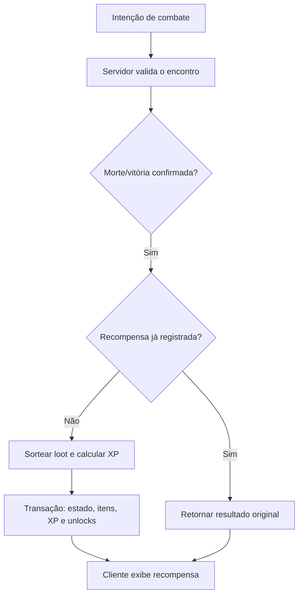

# Sprint 3 — Sistema mestre de loot, itens e drops

**Projeto:** Echoes of Aethel · **Versão:** 1.0 · **Estado:** especificação experimental; implementação e balanceamento pendentes.

Referência canônica para raridades, equipamento e recompensas. Substitui a tabela preliminar de quatro raridades. Usa os atributos da [Sprint 1](01_classes_e_atributos.md) e a autoridade/transação da [Sprint 2](02_arquitetura_tecnica.md).

> A cor revela a raridade; o nível do item, seus afixos e a construção do personagem determinam sua utilidade. Nenhuma escolha narrativa reduz permanentemente drops ou XP.

## 1. Hierarquia de raridade

| Raridade | ID | Cor / hex da UI | Prefixos | Sufixos | Total de afixos aleatórios | Efeito único |
|---|---|---|---:|---:|---:|---|
| Comum | common | Cinza `#B0B0B0` | 0 | 0 | 0 | Nenhum |
| Mágico | magic | Verde `#79C96B` | 1 | 0 | 1 | Nenhum |
| Raro | rare | Azul `#69A9F3` | 1 | 1 | 2 | Nenhum |
| Épico | epic | Roxo `#BD8BEA` | 2 | 1 | 3 | Nenhum |
| Lendário | legendary | Dourado `#E8C66A` | 2 | 2 | 4 | 1 propriedade fixa do template |

Prefixo/sufixo são categorias de geração, não texto digitado pelo cliente. Estatísticas base da arma/armadura não contam como afixo. Propriedade lendária fixa também não conta entre os quatro aleatórios. Neste baseline, equipamentos Mágicos sempre têm um prefixo; uma variação com um sufixo poderá ser avaliada depois sem mudar o total.

Não repetir `affix_id` nem grupo exclusivo no mesmo item. Templates precisam oferecer candidatos suficientes para a raridade; catálogo inválido bloqueia publicação. Geração filtra slot, família, nível e conflitos antes de sortear sem reposição. Não usar loops de reroll ilimitados.

UI combina cor, rótulo escrito e ícone; texto claro sobre painel azul-escuro. Testar contraste na UI real, sem presumir acessibilidade apenas pelo hex. Ícone/sprite do item pode manter cores próprias e recebe moldura da raridade.

### 1.1 Estatísticas e orçamento de afixos

| Grupo | Exemplos | Regras |
|---|---|---|
| Atributos | STR, DEX, INT, FTH, VIT | Valores inteiros; atributo efetivo continua limitado a 99 |
| Poder base | weapon_power / focus_power | Usado como W da Sprint 1, conforme o ataque; não somar arma e foco no mesmo componente |
| Defesa | armor, ward | Valores não negativos; somam equipamento antes da fórmula de mitigação |
| Resistência | fire, cold, sacred, arcane, poison | Limite final −50%…75%, por tipo |
| Ofensivo | bonus_damage_pct, bonus_crit_pct | Respeita teto total de dano/crítico da Sprint 1 |
| Sustentação | bonus_healing_pct | Teto final de 50%; não altera consumíveis sem regra explícita |

Nível de item (`item_level`) controla faixas de poder e afixos; requisito (`requirement_level`) controla quem pode equipar. Não são sinônimos. Ambos entre 1 e 30 neste baseline, sem item de nível superior à faixa autorizada da zona. Faixas por mapa serão definidas na Sprint 4. Cada afixo tem tier, peso, faixa inteira e custo de orçamento no catálogo. Antes de implementar, publicar esses catálogos e simular extremos; esta Sprint não inventa uma curva de DPS validada.

Lendários não podem adicionar proc recursivo: dano de proc não dispara outro proc da mesma cadeia. Efeito único tem ID, alvo permitido, cooldown e limite explícitos no template; não vem como script executável no JSON.

## 2. Equipamento e slots

| Slot / ID | Conteúdo | Restrição |
|---|---|---|
| Mão principal / main_hand | Espada, adaga, machado, cajado, maça, arco ou besta | Uma instância; requisitos de classe/família/nível |
| Mão secundária / off_hand | Escudo, adaga secundária ou foco | Indisponível com arma de duas mãos |
| Elmo / head | Elmo ou capuz | Uma instância |
| Peitoral / chest | Armadura, manto ou couro | Uma instância |
| Luvas / hands | Luvas | Uma instância |
| Botas / feet | Botas | Uma instância |
| Anel 1 / ring_1 | Anel | Instância diferente de ring_2 |
| Anel 2 / ring_2 | Anel | Mesmo template permitido; efeitos únicos do mesmo grupo não acumulam |
| Amuleto / neck | Amuleto | Uma instância |

Machados e escudos preservam o kit canônico do Bastião, além das famílias solicitadas. Anéis podem compartilhar template, nunca ID de instância. Equipar arma de duas mãos exige off_hand vazio; se ocupado, comando retorna erro recuperável para desequipar, sem descartar item silenciosamente.

| Família | Mãos | Classes previstas | Integração de combate |
|---|---|---|---|
| Espada | 1 | Bastião, Inquisidor | Alternativa física; exige animação compatível |
| Adaga | 1 | Sentinela | Escala DEX; secundária não concede segundo acerto automaticamente |
| Machado | 1 | Bastião | Kit inicial de STR |
| Cajado | 2 | Tecelão, Invocadora | Foco para magias e invocações |
| Maça | 1 | Inquisidor | STR em ataque físico; FTH em habilidade sagrada |
| Arco / besta | 2 | Sentinela, expansão futura | Família catalogada, mas não equipável até definir habilidades/animações de distância |
| Escudo | secundária | Bastião | Suporte visual/estatístico da guarda |
| Foco | secundária | Tecelão, Invocadora | Reservado a armas de uma mão compatíveis futuras; não combina com cajado de duas mãos |

Nenhuma família futura entra no pool de drop equipado do MVP sem suporte de combate. O catálogo pode registrá-la como desabilitada. Faltando equipamento, arma de treino base garante ataque gratuito; trocar arma nunca transforma habilidade não implementada em funcional.

### 2.1 Inventário e consumíveis

Baseline: 60 posições, equipamento ocupa uma posição e consumíveis/materiais empilham até 20 por stack. Equipados continuam no inventário com referência por ID, sem ocupar uma segunda posição. Ouro fica em campo inteiro separado, sem stack; todas as operações usam limites validados no domínio.

| Consumível | Efeito inicial | Uso / limite |
|---|---|---|
| Poção de Vida pequena | Restaura até 50 HP | Sem overflow; não consumir com vida cheia |
| Frasco de Éter pequeno | Restaura até 30 MP | Sem overflow; não consumir com MP cheio |
| Frasco de Antídoto | Remove efeitos etiquetados como veneno removível | Não cura Bruma, corrupção narrativa ou maldição de classe; sem efeito válido, não consumir |
| Pergaminho de Portal | Abre retorno ao último hub desbloqueado | Canalização de 3 s; sem uso em arena ativa de boss ou combate; bloqueio servidor |

Vida/MP compartilham cooldown de 5 s. Antídoto: cooldown próprio de 5 s. Portal: cooldown de 10 s após completar, consumido somente ao concluir; interrupção não consome nem muda checkpoint. Hub seguro nunca aplica dano, inclusive por efeito residual de veneno: remover/suspender efeitos de combate ao entrar conforme regra de transição.

Inventário cheio não elimina recompensa: resultado vai para `pending_rewards` persistente, limitado a 100 instâncias por personagem. Se a reserva não comportar a recompensa potencial, bloquear abertura de novo encontro com aviso para coletar/liberar espaço. Recompensa garantida não depende de clicar em um ícone antes de desconectar. UI representa o loot, mas sua propriedade já está registrada.

## 3. Tabelas de drop

### 3.1 Rolagens por inimigo

Cada coluna representa uma rolagem independente, realizada uma vez por morte validada. Ouro/material/essência não dependem de equipamento. Quantidade de equipamento: no máximo um por inimigo nesta versão. Receita de campanha segue regras únicas abaixo.

| Categoria | Chance equipamento | Chance ouro / quantidade | Chance consumível | Chance material | Chance essência |
|---|---:|---|---:|---:|---:|
| Comum | 12% | 60% / 1–5 | 15% | 5% | 0% |
| Elite / Campeão | 65% | 100% / 8–20 | 35% | 70% | 5% |
| Sub-boss | 100% | 100% / 25–50 | 60% | 100% | 100% |
| Boss de ato | 100% | 100% / 60–120 | 100% | 100% | 100% |

Quantidades iniciais para a primeira faixa de conteúdo; multiplicadores por ato, economia e materiais específicos serão catalogados, sem automatizar crescimento arbitrário. Material: uma unidade se rolado; essência: uma unidade; consumível: uma unidade. Essências usam elemento/afinidade do encontro. Nenhuma coluna é probabilidade de “todo loot”: por exemplo, um comum pode conceder ouro sem equipamento.

### 3.2 Raridade condicionada ao equipamento

Fazer esta rolagem somente se a chance de equipamento passou. Usar pesos inteiros com total 10.000, correspondentes às porcentagens abaixo, para evitar ambiguidades de ponto flutuante.

| Categoria | Comum | Mágico | Raro | Épico | Lendário | Total |
|---|---:|---:|---:|---:|---:|---:|
| Comum | 75% | 25% | 0% | 0% | 0% | 100% |
| Elite / Campeão | 0% | 60% | 38% | 2% | 0% | 100% |
| Sub-boss | 0% | 0% | 75% | 25% | 0% | 100% |
| Boss de ato | 0% | 0% | 0% | 90% | 10% | 100% |

> Exemplo: chance absoluta de um comum fornecer item Mágico = `12% × 25% = 3%`. Para um elite fornecer Raro: `65% × 38% = 24,7%`. “90% Épico” para boss é a divisão de raridade de um equipamento garantido, não chance adicional de um segundo item.

### 3.3 Bosses de ato e recompensa única

| Mapa | Boss | Equipamento por vitória autorizada | Receita única de primeira vitória | Fragmento |
|---|---|---|---|---|
| 3 | Silvano, o Traidor | 1 Épico ou Lendário | recipe.rootbound_guard — Guarda de Raiz | Sim; único por campanha |
| 6 | Malignus, o Colecionador de Ossos | 1 Épico ou Lendário | recipe.boneward_amulet — Amuleto do Ossuário | Sim; único por campanha |
| 9 | Gorgoroth, a Boca das Sombras | 1 Épico ou Lendário | recipe.abyssal_focus — Foco Abissal | Sim; único por campanha |
| 12 | Vael, o Sol-Negro | 1 Épico ou Lendário | recipe.eclipse_sigil — Selo do Eclipse | Sim; único por campanha |

Receita é desbloqueio de conhecimento garantido, não um item repetido vendável. Crafting correspondente é expansão futura; UI identifica “receita descoberta — fabricação ainda indisponível” no protótipo. Recompensa de Vael é persistida antes da escolha de final. Replay pós-campanha precisa de modo/encontro explicitamente autorizado; esta tabela não cria endgame automaticamente.

Primeira morte de boss registra receita e fragmento na mesma transação da vitória. Repetição autorizada concede loot normal, sem receita/fragmento extra. Unique key: `(character_id, campaign_id, reward_id)`. Repetir requisição da mesma vitória retorna o resultado original, nunca uma nova rolagem.

### 3.4 XP e seleção de itens

XP vem do catálogo de inimigo/encontro e é calculada no servidor. Fórmula proposta: `floor(base_xp × category_multiplier)`, multiplicadores comum=1, elite=3, sub-boss=8 e boss=20. `base_xp` por nível/zona e curva de level-up precisam ser definidos e simulados; não há valor universal de XP validado nesta Sprint.

No pool de equipamento, selecionar somente templates habilitados na faixa de nível, família e zona. Baseline solo: 80% do peso favorece templates equipáveis pela classe e 20% outros templates implementados. Se não houver candidato em um grupo, usar o outro; se nenhum grupo possuir candidato, catálogo inválido impede iniciar encontro, sem substituição silenciosa por ouro.

Lendários exigem templates válidos para o nível do boss; receita não é garantia de um lendário específico. Sem pity system ou reroll nesta versão. Crafting, comércio e destruição de itens receberão contratos próprios antes da implementação.

## 4. Dados JSON — FastAPI / PostgreSQL

### 4.1 Template e instância

Template define família, slots, visual e pools. Instância registra propriedade, resultado do roll e afixos. O exemplo usa os nomes solicitados; DTOs FastAPI podem expor aliases PascalCase e usar snake_case internamente. Não aceitar este documento completo como payload de criação enviado pelo jogador.

```json
{
  "SchemaVersion": 1,
  "ID": "a8dc331c-4cb2-4e79-8f23-98c8592a6791",
  "TemplateID": "weapon.twilight_axe",
  "OwnerCharacterID": "2d8c6c78-e7d4-4d3c-a31f-c39d8c94dd88",
  "Name": "Machado do Crepúsculo",
  "Rarity": "rare",
  "ItemLevel": 6,
  "RequirementLevel": 4,
  "EquipmentSlot": "main_hand",
  "WeaponFamily": "axe",
  "HandsRequired": 1,
  "RequiredClasses": ["twilight_bastion"],
  "Stats": {
    "weapon_power": 12,
    "STR": 2,
    "VIT": 1
  },
  "Affixes": [
    {"ID": "prefix.might", "Group": "attribute_strength", "Stat": "STR", "Value": 2, "Tier": 1},
    {"ID": "suffix.endurance", "Group": "attribute_vitality", "Stat": "VIT", "Value": 1, "Tier": 1}
  ],
  "UniqueEffectID": null,
  "SpriteAssetPath": "assets/paperdoll/bastion/axe_twilight_32.png",
  "SpriteAssetID": "paperdoll.bastion.axe_twilight.32",
  "ContentVersion": "gdd-loot-1",
  "Quantity": 1,
  "SourceEncounterID": "9b676cd1-fb15-48d8-8b56-143b64d0f110"
}
```

Exemplo de item Raro: exatamente um prefixo e um sufixo. `Stats` é projeção final do template + afixos; **não somar Affixes novamente no cálculo do personagem**. Fonte canônica é template versionado + afixos imutáveis, com validação da projeção ao persistir/carregar. Campos de nível são ilustrativos; não definem a faixa do Mapa 1.

`SpriteAssetPath` é caminho relativo conhecido do catálogo, sem `..`, protocolo ou acesso a arquivos arbitrários. Cliente resolve por `SpriteAssetID`; API não aceita uploads/URLs como equipamento. Caminhos do exemplo são contratos futuros, não assets já existentes.

### 4.2 Validação e armazenamento

| Campo | Validação de domínio |
|---|---|
| ID / OwnerCharacterID | UUIDs; instância pertence ao personagem autenticado |
| Rarity | Enum dos cinco IDs canônicos |
| Stats / Affixes | Lista permitida, tipos/ranges, tiers, contagem da raridade e grupos sem duplicação |
| RequirementLevel / ItemLevel | Inteiros 1–30, requisito ≤ nível de item; catálogo compatível |
| EquipmentSlot / HandsRequired | Família válida, slot permitido e conflito de duas mãos |
| UniqueEffectID | Obrigatório para Lendário; null nas outras raridades |
| Quantity | Equipamento sempre 1; stack de consumível/material 1–20 |
| SpriteAssetID / Path | Allowlist do catálogo; família paperdoll compatível |

Itens ficam no JSONB de `character_inventories`, com schema_version e versão otimista, conforme Sprint 2. Recompensa persistida contém IDs e resultado original. IDs de instância não repetem entre inventário, equipados e reserva; equipados apenas referenciam instâncias. Mercado futuro requer tabela relacional de propriedade antes de transferir entre personagens.

## 5. Autoridade, idempotência e aplicação de drops



Servidor valida vitória; não aceita seed, drop, XP, afixos ou HP final do cliente. Identificar morte comum por `(encounter_id, spawn_instance_id)`: nova expedição pode gerar novas instâncias, retry da mesma morte não. RNG seguro no modo online; RNG injetável e seeds conhecidas somente em testes/offline.

Transação bloqueia estado do encontro/personagem na ordem definida, registra morte, rola loot, atualiza XP/inventário/reserva, grava desbloqueios e resposta idempotente. Rollback não concede item parcial. Falha após commit permite ler a mesma resposta sem sortear de novo. Catálogo inválido é detectado antes de criar o encontro, reduzindo falhas no momento de recompensa.

## 6. Critérios de validação futura

- Catálogos: pesos de raridade somam 10.000; candidatos suficientes para afixos sem reposição; assets e famílias compatíveis; nenhum template futuro/desabilitado entra no drop.
- Probabilidades: testes estatísticos com amostra e tolerância declaradas, além de testes determinísticos dos limites de peso. Não confundir chance condicional e absoluta.
- Inventário: dois anéis usam IDs distintos; duas mãos bloqueiam off_hand; trocar equipamento não duplica atributos; reserva preserva drop com inventário cheio.
- Consumo: recurso cheio/efeito inexistente não gasta item; portal interrompido não cobra; cooldown e autoria validados no servidor.
- Concorrência: retry, morte duplicada, restart e vitória simultânea não repetem XP/loot/receita/fragmento.
- Balanceamento: medir ouro/hora, equipamentos/hora, tempo para upgrades, poder por nível e utilidade por classe. Valores deste documento não são desempenho ou economia aprovados.

Esta Sprint entrega especificação, tabelas e exemplo JSON. Não implementa sorteio, inventário, crafting ou assets de jogo.
