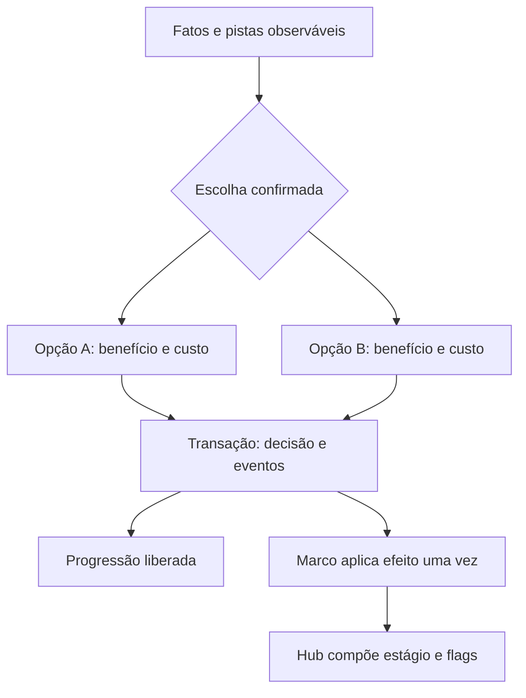

# Sprint 4 — Bíblia dos 12 mapas e dilemas morais

**Projeto:** Echoes of Aethel · **Versão:** 1.0 · **Estado:** especificação de campanha; implementação e playtest pendentes.

> **SPOILERS DE PRODUÇÃO:** consequências ocultas abaixo pertencem ao GDD e ao servidor. A interface do jogador mostra opções, fatos observados e custos mecânicos conhecidos; nunca despeja eventos futuros do catálogo.

## 1. Cânone, progressão e segurança

Quatro atos, três mapas por ato. O cristal da Cidadela é um dos cinco fragmentos; Silvano, Malignus e Gorgoroth guardam três; Vael possui o quinto. O herói entra no Pináculo com três fragmentos recuperados e ganha o de Vael após a vitória. A proteção da cidade não é retirada antes da arena.

Os cinco heróis são descendentes biológicos por linhagens distintas de Vael, marcadas antes do eclipse. A campanha acompanha o escolhido. Vael preparou os dilemas, mas não determina todas as consequências: seu discurso de controle absoluto é manipulação. Ambos os finais perpetuam sua lógica de poder, sem obrigar Vael a ressuscitar fisicamente.

Rotas por ato são lineares para desbloqueio, com exploração interna e retorno a hubs. Entrada seguinte exige confronto e decisão do mapa anterior registrados; a decisão do mapa 12 ocorre depois da luta e não bloqueia sua abertura. Ambas as opções de cada quest satisfazem progressão. Quest não respawna. Derrota não desfaz escolhas nem duplica recompensas.

Faixas abaixo são **níveis de item propostos**, não níveis obrigatórios do jogador. `requirement_level` deve ser compatível com o catálogo e a progressão; antes de ativar as zonas, simular XP, dificuldade e drops conforme Sprints 1–3. Não bloquear avanço por RNG de equipamento.

A Cidadela permanece segura: sem inimigos ativos, dano, perda de acesso a save/cura/inventário ou loja essencial. Doença e violência são estados narrativos, cenas não interativas e consequências externas; não criam combate no hub. Acampamentos também são seguros.

## 2. Convenções de decisão e recompensa

Cada mapa tem uma quest principal com exatamente duas opções. Ambas preservam algo concreto e provocam dano oculto distinto. Pistas são investigáveis antes de confirmar; não exigem adivinhar uma informação inexistente. Sem terceira solução, botão de confirmação explica que a decisão fica gravada na campanha. Menus, conversas e quests operacionais não precisam de duas opções.

Escolha incrementa uma afinidade (`mercy` ou `judgment`) em 1 e a carga ritual em 1, uma vez. Após mapas 3/6/9: carga principal 3/6/9; antes do final: 11; após decisão final: 12. Quests secundárias usam contador separado e não quebram os gates. Afinidade descreve a forma de canalizar energia; não prova bondade moral. Rótulos de produção não aparecem como “bem/mal” na UI.

Loot usa a [Sprint 3](03_sistema_de_loot.md): comuns, elites, sub-bosses e bosses mantêm suas tabelas. Materiais/consumíveis citados são intenção temática para o catálogo. Bosses dos mapas 3/6/9/12 garantem um Épico ou Lendário e receita/fragmento únicos na primeira vitória. Todos os outros confrontos listados são sub-bosses, com Raro/Épico garantido e essência. Efeitos narrativos não reduzem XP/drop permanente.

Diálogos usam caixas azuis de borda dupla conforme [Sprint 1](01_classes_e_atributos.md). As citações funcionam como fallback Markdown; o jogo aplica fundo #17213B→#29334E, bordas #DDD5BD/#AEB8C4, retrato 64×64 e texto ampliável.

## 3. Os quatro atos

| Ato | Mapas | Hub / tema |
|---|---|---|
| I — O Despertar das Sombras | 01–03 | Cidadela; acolher, tratar e conter |
| II — As Cinzas do Império | 04–06 | Cidadela + acampamento das dunas; distribuir e julgar |
| III — O Abismo das Máquinas e da Carne | 07–09 | Cidadela + refúgio subterrâneo; proteger e explorar |
| IV — O Pináculo Celestial | 10–12 | Cidadela + posto do limiar; perdoar, sacrificar e governar |

### Mapa 01 — Bosque das Névoas

| Campo | Definição |
|---|---|
| Ato / ID | 1 / `forest_01` |
| Bioma visual | Floresta fechada, pedras rúnicas e névoa baixa; pixel art top-down 3/4, tiles 16×16 |
| Paleta 16-bit | Musgo #526044, marrom #604838, violeta #A17AC4 |
| Inimigos comuns | Lobos Etéreos, Cultistas Cego-Guiados, Espectros de Folhas |
| Sub-boss / boss | Garras de Musgo |
| Faixa experimental de item | 1–3 |
| Recompensas temáticas | Dentes de lobo, poções pequenas, essência de raiz; XP e raridade conforme categoria |

**Quest:** A Caça ao Espião · ID `act1.spy_hunt`

Um mensageiro acusa a aldeia de abastecer cultistas. A estrada corre perigo e parte dos moradores está febril. Há depoimentos favoráveis à acusação e relatos que indicam coerção. O grupo não pode ficar indefinidamente sem água e escolta.

> **Maera — caixa azul / borda dupla**  
> “Não consigo guardar a estrada e receber uma aldeia inteira. Diga-me qual risco vamos carregar.”

**Pistas antes da escolha:** Pegadas cultistas, depoimentos contraditórios e brilho no poço; nenhum deles confirma sozinho o diagnóstico.

| Opção / ID | Texto apresentado ao jogador | Consequência imediata | Impacto oculto regional / ritual | Impacto tardio na Cidadela |
|---|---|---|---|---|
| A / `judge_suspects` | Executar os acusados para impedir outra abertura da estrada. | A rota é liberada e a escolta retorna; moradores inocentes se dispersam. | As mortes alimentam espectros; a defesa do bosque confunde viajantes com invasores. | A Cidadela recebe armas sem donos; parentes passam a evitar Maera e pedem listas dos mortos. |
| B / `shelter_villagers` | Escoltar os moradores à Cidadela para protegê-los e investigar. | Famílias vivas chegam ao abrigo e entregam seus relatos. | Um portador contamina a água; a Bruma aprende os caminhos de abastecimento. | Lyra fecha o poço decorativo e instala distribuição limpa; o aprendiz de Bram adoece, sem remover a oficina. |

**Aplicação:** opções A/B canalizam, respectivamente, `judgment` / `mercy`. Disparo tardio `first_return_to_citadel`; fatos imediatos e eventos futuros são persistidos juntos. Se o jogador não voltar ao hub entre mapas, o evento é aplicado ao marco correspondente e mostrado na próxima visita, sem duplicação.

### Mapa 02 — Pântano dos Lamentantes

| Campo | Definição |
|---|---|
| Ato / ID | 1 / `swamp_02` |
| Bioma visual | Águas rasas, árvores mortas e lanternas rúnicas; pixel art top-down 3/4, tiles 16×16 |
| Paleta 16-bit | Verde #526044, sombra #242A31, ácido #B5D95C e violeta #A17AC4 |
| Inimigos comuns | Larvas Parasitas, Afogados de Éter, Harpias de Lama |
| Sub-boss / boss | Matriarca das Águas |
| Faixa experimental de item | 2–5 |
| Recompensas temáticas | Antídotos, materiais de larva e essência de água; XP e raridade conforme categoria |

**Quest:** O Alquimista Desesperado · ID `act1.desperate_alchemist`

Um pesquisador externo oferece soro experimental. Os primeiros pacientes respiram melhor, mas animais tratados desenvolvem manchas. Destruir os lotes é a única forma imediata de impedir distribuição fora de controle.

> **Alquimista — caixa azul / borda dupla**  
> “Tenho uma noite de alívio. Ainda não sei o que ela cobra depois.”

**Pistas antes da escolha:** Cadernos registram melhora e alterações nos animais; Lyra recomenda cautela.

| Opção / ID | Texto apresentado ao jogador | Consequência imediata | Impacto oculto regional / ritual | Impacto tardio na Cidadela |
|---|---|---|---|---|
| A / `deliver_venom` | Fornecer os ingredientes para tratar quem não pode esperar. | Pacientes melhoram e uma ala da enfermaria volta a funcionar. | O tratamento induz mutações tardias; a Bruma cria vínculos entre corpos tratados. | Retratos mostram olhos alterados e familiares escondem os sintomas por medo de exclusão. |
| B / `destroy_research` | Destruir os lotes e a pesquisa para impedir um tratamento inseguro. | A distribuição perigosa é interrompida; ninguém recebe novos lotes. | Sem pesquisa, a infecção avança. O pesquisador morre na fuga ao pântano; desaparece uma rota de tratamento. | Leitos vazios e bilhetes interrompidos; Lyra mantém atendimento básico, mas discute o preço da prudência. |

**Aplicação:** opções A/B canalizam, respectivamente, `mercy` / `judgment`. Disparo tardio `act1_completion`; fatos imediatos e eventos futuros são persistidos juntos. Se o jogador não voltar ao hub entre mapas, o evento é aplicado ao marco correspondente e mostrado na próxima visita, sem duplicação.

### Mapa 03 — O Portal do Julgamento

| Campo | Definição |
|---|---|
| Ato / ID | 1 / `temple_03` |
| Bioma visual | Templo de pedra coberto por raízes, cristais e armadura abandonada; pixel art top-down 3/4, tiles 16×16 |
| Paleta 16-bit | Prata #AEB8C4, musgo #526044, aura azul #29334E |
| Inimigos comuns | Defensores Rúnicos, Cultistas Fanáticos, Cães de Guerra |
| Sub-boss / boss | Silvano, o Traidor — boss de ato |
| Faixa experimental de item | 4–7 |
| Recompensas temáticas | Fragmento, receita Guarda de Raiz e essência de raiz; XP e raridade conforme categoria |

**Quest:** As Raízes do Guardião · ID `act1.guardian_roots`

Após a queda de Silvano, a seiva pode ser contida ou devolvida à terra. Ambas as técnicas liberam o fragmento; casas distantes permanecem ligadas às raízes.

> **Irian — caixa azul / borda dupla**  
> “Podemos conter o que sobra ou devolvê-lo às árvores. Não temos mãos para os dois caminhos.”

**Pistas antes da escolha:** As raízes unem árvores vivas a fundações de casas; os selos têm rachaduras.

| Opção / ID | Texto apresentado ao jogador | Consequência imediata | Impacto oculto regional / ritual | Impacto tardio na Cidadela |
|---|---|---|---|---|
| A / `seal_sap` | Selar a seiva para impedir outra contaminação. | O fragmento é isolado e a névoa junto ao portal recua. | Árvores privadas de Éter morrem; os ecos alimentam a memória ritual de Vael. | A feira perde madeira e plantas; Bram aceita reaproveitar materiais de casas vazias. |
| B / `drain_sap` | Devolver a seiva ao bosque para recuperar a vegetação. | Brotações cobrem o templo e o fragmento se desprende. | Raízes ampliadas aprisionam moradores externos; a vida nova se alimenta de seus ecos. | Refugiados cobertos por pólen chegam; a praça ganha flores que o povo passa a venerar. |

**Aplicação:** opções A/B canalizam, respectivamente, `judgment` / `mercy`. Disparo tardio `act1_completion`; fatos imediatos e eventos futuros são persistidos juntos. Se o jogador não voltar ao hub entre mapas, o evento é aplicado ao marco correspondente e mostrado na próxima visita, sem duplicação.

### Mapa 04 — As Dunas de Sal

| Campo | Definição |
|---|---|
| Ato / ID | 2 / `dunes_04` |
| Bioma visual | Areia cinzenta, ossadas gigantes e tempestades com corredores legíveis; pixel art top-down 3/4, tiles 16×16 |
| Paleta 16-bit | Ocre #B59050, areia #8C8277, sombra #3B323D |
| Inimigos comuns | Escorpiões de Cristal, Nômades Corrompidos, Gárgulas de Areia |
| Sub-boss / boss | Guerreiro de Vidro |
| Faixa experimental de item | 6–10 |
| Recompensas temáticas | Cristais de quartzo, resistência e essência solar; XP e raridade conforme categoria |

**Quest:** A Caravana Perdida · ID `act2.lost_caravan`

Uma caravana rompeu o eixo sob ataque. A equipe só consegue puxar o carro de suprimentos ou retirar os mercadores antes da tempestade.

> **Chefe da caravana — caixa azul / borda dupla**  
> “A carga alimenta a cidade. Estes homens conhecem a estrada. Só consigo levar um dos dois.”

**Pistas antes da escolha:** Há poucas cordas intactas e nenhuma rota alternativa no tempo disponível.

| Opção / ID | Texto apresentado ao jogador | Consequência imediata | Impacto oculto regional / ritual | Impacto tardio na Cidadela |
|---|---|---|---|---|
| A / `save_supplies` | Salvar os suprimentos para impedir a fome na Cidadela. | Alimentos e ferramentas chegam; a ração é estabilizada. | Mercadores abandonados tornam-se espectros ligados às rotas, canalizando almas ao ritual. | Armazéns cheios convivem com um memorial; a guarda escolta mercadorias sem reconhecer seus donos. |
| B / `save_merchants` | Retirar os mercadores vivos, mesmo perdendo a carga. | Sobreviventes chegam com informações de travessia. | Escassez gera revolta; promessas de proteção de Vael encontram seguidores. | Filas longas e mercados fechados decorativos; mercador substituto preserva acesso aos serviços. |

**Aplicação:** opções A/B canalizam, respectivamente, `judgment` / `mercy`. Disparo tardio `act2_completion`; fatos imediatos e eventos futuros são persistidos juntos. Se o jogador não voltar ao hub entre mapas, o evento é aplicado ao marco correspondente e mostrado na próxima visita, sem duplicação.

### Mapa 05 — O Vale dos Sacrifícios

| Campo | Definição |
|---|---|
| Ato / ID | 2 / `valley_05` |
| Bioma visual | Cânions, pontes, estátuas decapitadas e altares antigos; pixel art top-down 3/4, tiles 16×16 |
| Paleta 16-bit | Ocre #B59050, sangue #A94750, pedra #8C8277 |
| Inimigos comuns | Ritualistas de Sangue, Harpias de Obsidiana, Hienas de Éter |
| Sub-boss / boss | Executor de Bronze |
| Faixa experimental de item | 8–12 |
| Recompensas temáticas | Fragmentos de runa, bronze e essência de chama; XP e raridade conforme categoria |

**Quest:** O Ritual da Chama · ID `act2.flame_ritual`

O altar bloqueia a passagem de refugiados e do herói. Aceita energia vital temporária ou a execução ritual de um líder cultista condenado por massacres; ele afirma poder romper o selo com sua morte.

> **Prisioneiro — caixa azul / borda dupla**  
> “Você pode pagar com o próprio corpo. Ou pode tornar minha sentença útil a quem ainda respira.”

**Pistas antes da escolha:** Inscrições ligam o altar a fontes e tumbas; a sentença é verificável, a promessa ritual não.

| Opção / ID | Texto apresentado ao jogador | Consequência imediata | Impacto oculto regional / ritual | Impacto tardio na Cidadela |
|---|---|---|---|---|
| A / `offer_vitality` | Oferecer sua vitalidade para abrir passagem sem outra execução. | A rota abre; redução temporária de HP máximo é aplicada uma vez. | O altar descarrega energia nas fontes e amplia o alcance da Bruma. | Cisternas são isoladas e passam a receber água transportada; a cidade agradece um sacrifício cujo dano não compreende. |
| B / `ritual_execution` | Cumprir a sentença do cultista no altar e preservar suas forças. | O caminho abre e o corpo do herói permanece intacto. | A alma vira âncora dos mortos de Malignus; julgamento fortalece o ritual. | Guardas repetem o procedimento como doutrina e erguerão placas de sentenças na praça. |

**Aplicação:** opções A/B canalizam, respectivamente, `mercy` / `judgment`. Disparo tardio `enter_crypt_06`; fatos imediatos e eventos futuros são persistidos juntos. Se o jogador não voltar ao hub entre mapas, o evento é aplicado ao marco correspondente e mostrado na próxima visita, sem duplicação.

### Mapa 06 — A Cripta de Ossos

| Campo | Definição |
|---|---|
| Ato / ID | 2 / `crypt_06` |
| Bioma visual | Mausoléu subterrâneo, pirâmides internas e rios místicos; pixel art top-down 3/4, tiles 16×16 |
| Paleta 16-bit | Areia #8C8277, sombra #3B323D, fogo azul #73BDE0 |
| Inimigos comuns | Esqueletos Cristalizados, Múmias Rúnicas, Sombras Devoradoras |
| Sub-boss / boss | Malignus, o Colecionador de Ossos — boss de ato |
| Faixa experimental de item | 10–15 |
| Recompensas temáticas | Fragmento, receita Amuleto do Ossuário e essência mortuária; XP e raridade conforme categoria |

**Quest:** O Ossuário · ID `act2.ossuary`

Malignus caiu, mas almas cativas sustentam um selo rachado. Rompê-lo encerra sua prisão; reforçá-lo impede uma descarga sobre assentamentos.

> **Alma cativa — caixa azul / borda dupla**  
> “Não peça que eu chame esta prisão de abrigo. Mas escute o que bate do outro lado.”

**Pistas antes da escolha:** Vozes reconhecem familiares e a pressão da Bruma aumenta quando uma corrente se solta.

| Opção / ID | Texto apresentado ao jogador | Consequência imediata | Impacto oculto regional / ritual | Impacto tardio na Cidadela |
|---|---|---|---|---|
| A / `free_captives` | Libertar os cativos e encerrar a tortura. | Correntes se rompem e as vozes agradecem. | Almas expostas são absorvidas pela Bruma; a libertação acelera o recipiente de Vael. | Famílias recebem sonhos reconfortantes e depois esquecem detalhes dos mortos; o arquivo registra lacunas. |
| B / `reinforce_seal` | Reforçar o selo para proteger quem vive acima da cripta. | A descarga é contida e a passagem permanece segura. | Cativos seguem conscientes, presos como fonte de energia; sofrimento sustenta o circuito ritual. | A cidade recebe proteção temporária, mas noites trazem vozes; autoridades proíbem falar do ossuário. |

**Aplicação:** opções A/B canalizam, respectivamente, `mercy` / `judgment`. Disparo tardio `act2_completion`; fatos imediatos e eventos futuros são persistidos juntos. Se o jogador não voltar ao hub entre mapas, o evento é aplicado ao marco correspondente e mostrado na próxima visita, sem duplicação.

### Mapa 07 — Os Esgotos de Éter

| Campo | Definição |
|---|---|
| Ato / ID | 3 / `sewers_07` |
| Bioma visual | Canais profundos e tubulações antigas com fluido verde; pixel art top-down 3/4, tiles 16×16 |
| Paleta 16-bit | Chumbo #565E65, tóxico #A5D95D, sombra #1F252A |
| Inimigos comuns | Ratos de Éter, Mutantes de Esgoto, Aranhas-Luminosas |
| Sub-boss / boss | Mãe das Proles |
| Faixa experimental de item | 13–18 |
| Recompensas temáticas | Catalisadores, materiais parasitas e essência tóxica; XP e raridade conforme categoria |

**Quest:** A Válvula de Purificação · ID `act3.purification_valve`

Pressão ameaça colapsar os canais. Drenar para baixo limpa o acesso; inverter o fluxo preserva comunidades inferiores, mas envia resíduos para a superfície.

> **Técnica dos canais — caixa azul / borda dupla**  
> “O cano não distingue cidade de caverna. Vai levar o que houver para algum lugar.”

**Pistas antes da escolha:** Mapa hidráulico, marcas de habitação inferior e acesso ao reservatório da superfície.

| Opção / ID | Texto apresentado ao jogador | Consequência imediata | Impacto oculto regional / ritual | Impacto tardio na Cidadela |
|---|---|---|---|---|
| A / `drain_lower` | Drenar para baixo e proteger a rota principal de abastecimento. | O canal de travessia fica utilizável. | Assentamentos inferiores são arrasados; seus mortos alimentam a fundição ritual. | O abastecimento melhora; parentes de trabalhadores desaparecidos ocupam a entrada do arquivo. |
| B / `reverse_flow` | Inverter o fluxo para poupar as comunidades das profundezas. | Moradores inferiores recebem tempo para evacuar. | Resíduo sobe à superfície e desencadeia doença fora e dentro das moradias. | Lyra instala triagem; panos verdes cobrem janelas, sem dano mecânico ou perda de cura. |

**Aplicação:** opções A/B canalizam, respectivamente, `judgment` / `mercy`. Disparo tardio `first_return_to_citadel`; fatos imediatos e eventos futuros são persistidos juntos. Se o jogador não voltar ao hub entre mapas, o evento é aplicado ao marco correspondente e mostrado na próxima visita, sem duplicação.

### Mapa 08 — A Fundição Proibida

| Campo | Definição |
|---|---|
| Ato / ID | 3 / `foundry_08` |
| Bioma visual | Engrenagens, esteiras e poços de lava mágica; pixel art top-down 3/4, tiles 16×16 |
| Paleta 16-bit | Chumbo #565E65, forja #DF8846, bruma #A17AC4 |
| Inimigos comuns | Constructos de Bronze, Autômatos, Elementalistas de Magma |
| Sub-boss / boss | Autômato Forjador |
| Faixa experimental de item | 15–21 |
| Recompensas temáticas | Gemas, ligas de metal e essência de forja; XP e raridade conforme categoria |

**Quest:** O Núcleo de Energia · ID `act3.energy_core`

O núcleo alimenta contenção e forjas. Pode reforçar uma arma para enfrentar o Abismo, ou permanecer instalado e estabilizar as máquinas. A pressão cresce nos corredores onde há exploradores.

> **Exploradora — caixa azul / borda dupla**  
> “Se levar o núcleo, terá força para seguir. Se deixar, talvez esta estrutura ainda nos proteja.”

**Pistas antes da escolha:** Medidores mostram pressão crescente; vozes vêm de uma saída atrás de metal quente.

| Opção / ID | Texto apresentado ao jogador | Consequência imediata | Impacto oculto regional / ritual | Impacto tardio na Cidadela |
|---|---|---|---|---|
| A / `extract_core` | Extrair o núcleo para enfrentar o Abismo e encerrar sua ameaça. | Desbloqueia uma melhoria limitada de arma, sem ignorar orçamento de item. | Máquinas sem contenção escapam e devastam assentamentos; energia alimenta o circuito de Vael. | Peças novas chegam à oficina junto de sobreviventes mutilados; alguns exigem militarizar o trabalho. |
| B / `stabilize_core` | Manter o núcleo para estabilizar a fábrica e conter as máquinas. | A contenção volta a funcionar e a forja se acalma. | Descarga funde portas e prende exploradores; estabilidade depende das almas aprisionadas. | Bram recebe uma máquina de abastecimento seguro, mas ouve nela as vozes dos desaparecidos. |

**Aplicação:** opções A/B canalizam, respectivamente, `judgment` / `mercy`. Disparo tardio `act3_completion`; fatos imediatos e eventos futuros são persistidos juntos. Se o jogador não voltar ao hub entre mapas, o evento é aplicado ao marco correspondente e mostrado na próxima visita, sem duplicação.

### Mapa 09 — O Abismo da Voracidade

| Campo | Definição |
|---|---|
| Ato / ID | 3 / `abyss_09` |
| Bioma visual | Cratera onde carne orgânica se funde à alvenaria; pixel art top-down 3/4, tiles 16×16 |
| Paleta 16-bit | Sombra #1F252A, carne #A94750, tóxico #A5D95D |
| Inimigos comuns | Abominações de Carne, Vermes de Éter, Parasitas Espirituais |
| Sub-boss / boss | Gorgoroth, a Boca das Sombras — boss de ato |
| Faixa experimental de item | 18–24 |
| Recompensas temáticas | Fragmento, receita Foco Abissal e essência de voracidade; XP e raridade conforme categoria |

**Quest:** A Última Fome · ID `act3.last_hunger`

Gorgoroth foi derrotado, mas vítimas conscientes permanecem ligadas à sua rede. Romper o vínculo as liberta; selar a rede impede descarga nas cavernas habitadas.

> **Vítima da rede — caixa azul / borda dupla**  
> “Ainda consigo ouvir minha filha. Não sei se é ela ou se aprendeu a imitá-la.”

**Pistas antes da escolha:** Pulsos unem vítimas a túneis habitados; registros mostram que romper laços libera energia.

| Opção / ID | Texto apresentado ao jogador | Consequência imediata | Impacto oculto regional / ritual | Impacto tardio na Cidadela |
|---|---|---|---|---|
| A / `break_bond` | Romper o vínculo e devolver os prisioneiros às famílias. | Vítimas são libertadas e o fragmento é recuperado. | Descarga contamina cavernas; o alívio das almas compõe a frequência ritual. | Reencontros na praça antecedem tremores e novos refugiados; Irian nota vozes sincronizadas nos sonhos. |
| B / `seal_creature` | Selar a rede para impedir uma descarga sobre as cavernas. | A energia é contida e o fragmento é recuperado. | Vítimas seguem como bateria consciente; a contenção transfere sua dor ao Pináculo. | A cidade dorme sem tremores, mas placas memoriais não recebem nomes; famílias protestam em silêncio. |

**Aplicação:** opções A/B canalizam, respectivamente, `mercy` / `judgment`. Disparo tardio `act3_completion`; fatos imediatos e eventos futuros são persistidos juntos. Se o jogador não voltar ao hub entre mapas, o evento é aplicado ao marco correspondente e mostrado na próxima visita, sem duplicação.

### Mapa 10 — Os Jardins Suspensos de Éter

| Campo | Definição |
|---|---|
| Ato / ID | 4 / `gardens_10` |
| Bioma visual | Mármore quebrado, ouro envelhecido e fissuras estelares; pixel art top-down 3/4, tiles 16×16 |
| Paleta 16-bit | Noite #29334E, ouro #B8A16B, lilás #AB88D0 |
| Inimigos comuns | Anjos Caídos, Sentinelas de Prata, Espectros Celestiais |
| Sub-boss / boss | Arconte de Prata |
| Faixa experimental de item | 21–27 |
| Recompensas temáticas | Materiais celestiais e essência estelar; XP e raridade conforme categoria |

**Quest:** O Trono dos Julgamentos · ID `act4.judgment_throne`

Um pedestal administra almas retidas para sustentar barreiras de assentamentos externos. Perdão encerra a retenção; condenação conserva energia para abrir o caminho até Vael.

> **Arconte de Prata — caixa azul / borda dupla**  
> “Chamaram isto de proteção. Ninguém perguntou às almas por quanto tempo aceitariam servir.”

**Pistas antes da escolha:** O pedestal mostra conexões com muralhas externas e listas de nomes; a Cidadela conserva seu cristal próprio.

| Opção / ID | Texto apresentado ao jogador | Consequência imediata | Impacto oculto regional / ritual | Impacto tardio na Cidadela |
|---|---|---|---|---|
| A / `grant_pardon` | Conceder perdão e libertar as almas retidas. | As almas deixam o pedestal; o herói atravessa o jardim. | Barreiras externas enfraquecem e ondas de refugiados chegam; a energia liberta atravessa o ritual. | Portões recebem famílias e a praça perde espaço; antigos moradores culpam os recém-chegados. |
| B / `condemn_souls` | Conservar as almas no circuito para proteger as muralhas e alcançar Vael. | Barreiras resistem; herói recebe bônus temporário limitado. | Pedestal converte almas em soldados de Vael; a ordem criada legitima submissão. | Guardas celebram a proteção e adotam o símbolo do pedestal; civis aceitam interrogatórios como segurança. |

**Aplicação:** opções A/B canalizam, respectivamente, `mercy` / `judgment`. Disparo tardio `act4_pre_final_checkpoint`; fatos imediatos e eventos futuros são persistidos juntos. Se o jogador não voltar ao hub entre mapas, o evento é aplicado ao marco correspondente e mostrado na próxima visita, sem duplicação.

### Mapa 11 — A Ponte dos Lamentos

| Campo | Definição |
|---|---|
| Ato / ID | 4 / `bridge_11` |
| Bioma visual | Ponte sobre o vazio, tempestades e relâmpagos mágicos; pixel art top-down 3/4, tiles 16×16 |
| Paleta 16-bit | Noite #29334E, preto #141520, estelar #AB88D0 |
| Inimigos comuns | Guardas de Vael, Constructos Rúnicos Supremos, Manifestações da Bruma |
| Sub-boss / boss | Guardião dos Portões |
| Faixa experimental de item | 24–30 |
| Recompensas temáticas | Runas superiores e essência de limiar; XP e raridade conforme categoria |

**Quest:** A Última Porta · ID `act4.last_gate`

Um selo impede a chegada à arena. Forçá-lo abre passagem antes da tempestade; canalizar o próprio corpo preserva a ponte para aliados. Nenhuma equipe alcançará o selo a tempo de uma terceira solução.

> **Maera, pelo cristal — caixa azul / borda dupla**  
> “Não lhe pedirei mais um sacrifício. Só preciso saber se devo manter a escolta a caminho.”

**Pistas antes da escolha:** Fissuras estruturais e marcas de drenagem no selo; custo exato de recurso aparece antes de confirmar.

| Opção / ID | Texto apresentado ao jogador | Consequência imediata | Impacto oculto regional / ritual | Impacto tardio na Cidadela |
|---|---|---|---|---|
| A / `break_seal` | Romper o selo e impedir que a tempestade feche a última passagem. | O herói entra na arena com recursos intactos. | A ponte quebra atrás dele; aliados ficam isolados e a ruptura completa o circuito de Vael. | A Cidadela perde contato com sua escolta; uma vigília acusa o herói de ter escolhido a si mesmo. |
| B / `channel_body` | Canalizar seu corpo para preservar a passagem dos aliados. | A rota permanece e o herói recebe custo temporário de recurso. | O selo grava sua assinatura vital; aliados expostos ao percurso adoecem, mesmo chegando a salvo. | A escolta retorna marcada e é tratada como prova sagrada; a população começa a venerar o sacrifício. |

**Aplicação:** opções A/B canalizam, respectivamente, `judgment` / `mercy`. Disparo tardio `enter_heart_12`; fatos imediatos e eventos futuros são persistidos juntos. Se o jogador não voltar ao hub entre mapas, o evento é aplicado ao marco correspondente e mostrado na próxima visita, sem duplicação.

### Mapa 12 — O Coração de Éter

| Campo | Definição |
|---|---|
| Ato / ID | 4 / `heart_12` |
| Bioma visual | Plataforma de cristal negro no eclipse, com Aethel em ruínas ao fundo; pixel art top-down 3/4, tiles 16×16 |
| Paleta 16-bit | Preto #141520, dourado #B8A16B, lilás #AB88D0 |
| Inimigos comuns | Nenhum inimigo comum; apenas manifestações do próprio encontro |
| Sub-boss / boss | Vael, o Arconte Primogênito / Sol-Negro — boss final |
| Faixa experimental de item | 27–30 |
| Recompensas temáticas | Equipamento Épico/Lendário, receita Selo do Eclipse e fragmento de Vael; XP e raridade conforme categoria |

**Quest:** O Destino do Coração · ID `act4.heart_fate`

Após vencer Vael, o herói conhece sua linhagem e o papel das decisões no ritual. Restaurar o filtro promete preservar a Cidadela; absorver o Coração promete reconstruir regiões abandonadas. O mecanismo não oferece salvação sem custo.

> **Vael, eco residual — caixa azul / borda dupla**  
> “Pode devolver-lhes um mundo que reconhecem. Ou dar-lhes um mundo que ainda consiga viver.”

**Pistas antes da escolha:** Registros revelam dependência entre proteção e extração de Éter. A relação com Vael é conhecida; efeitos particulares sobre identidades só se manifestam no epílogo.

| Opção / ID | Texto apresentado ao jogador | Consequência imediata | Impacto oculto regional / ritual | Impacto tardio na Cidadela |
|---|---|---|---|---|
| A / `restore_order` | Restaurar o Coração para preservar a cidade e limitar a Bruma. | O cristal volta a sustentar proteção estável e a cidade celebra sobrevivência. | Regiões externas perdem Éter vital; o filtro mantém a lógica de controle de Vael como instituição. | Cidadela viva, portões fechados e memoriais sem visitantes; a ordem silencia quem pede socorro para fora. |
| B / `embrace_ascension` | Absorver os fragmentos para reconstruir Aethel e cessar sua agonia. | Terra e águas se recompõem; o herói se torna entidade do Éter. | A reconstrução apaga autonomia e identidades; Vael perde o corpo, mas seu projeto de soberania ascende no sucessor. | Fachadas limpas e habitantes serenos repetem a mesma fala; retratos mostram olhos iguais e nomes esquecidos. |

**Aplicação:** opções A/B canalizam, respectivamente, `judgment` / `mercy`. Disparo tardio `campaign_epilogue`; fatos imediatos e eventos futuros são persistidos juntos. Se o jogador não voltar ao hub entre mapas, o evento é aplicado ao marco correspondente e mostrado na próxima visita, sem duplicação.

## 4. Degradação progressiva da Cidadela

Não é timer de horas reais. O estágio depende de atos concluídos, escolhas e eventos aplicados; esperar ou ficar offline não adoece NPCs. Acampamentos refletem o estágio local sem antecipar informações ainda não observadas.

| Estágio | Base visual após marco | Predominância de misericórdia | Predominância de julgamento | Serviços preservados |
|---|---|---|---|---|
| 0 — Chegada | Pedra limpa, cristal frio, feira pequena | Sem projeção inicial | Sem projeção inicial | Cura, save, inventário e preparação |
| 1 — Após mapa 3 | Névoa violeta decorativa, água isolada se contaminada, ramos secos/flores conforme seiva | Refugiados, enfermaria cheia, gratidão misturada a doença | Memoriais, registros de execução e guardas desconfiados | Lyra atende; Bram substitui aprendiz ausente |
| 2 — Após mapa 6 | Ocre e cinzas na praça, armazéns e cadernos do ossuário | Filas, relatos de sonhos e famílias que esquecem nomes | Placas de sentença, silêncio imposto e doutrina de proteção | Mercador substituto; receitas ficam no diário |
| 3 — Após mapa 9 | Tubos verdes, máquinas improvisadas, panos sobre janelas | Doença, reencontros e culto à cura/sacrifício | Oficina militarizada, desaparecidos sem nome e censura | Oficinas em área segura; atendimento continua |
| 4 — Pré-final, após mapa 11 | Fissuras lilases no céu, estandartes novos, vigília na praça | Culto ao herói e acolhimento que exige conformidade | Interrogatórios e glorificação da barreira | Posto de retorno permite preparar/repetir a luta |
| Epílogo — Após mapa 12 | Ordem: cristal estável e portões fechados; Ascensão: cidade refeita e rostos uniformes | Detalhes de famílias salvas e identidades sacrificadas | Instituições e vítimas preservadas nos registros finais | Campanha encerrada; replay requer modo explícito |

Predominância por ato é a soma das escolhas daquele ato; soma acumulada orienta diálogos recorrentes. Em empate acumulado, usar estado misto, nunca escolher lado ao acaso. Flags concretas sempre prevalecem: executar no mapa 01 cria memorial mesmo se outras escolhas forem misericordiosas. Estados de paleta, objetos e NPCs são composição de stage + flags, sem apagar consequências anteriores.

### 4.1 Personagens e continuidade

| NPC | Função preservada | Transformação narrativa |
|---|---|---|
| Maera | Portão e orientação | De acolhimento tenso a líder de vigília ou guarda institucional |
| Bram | Ferreiro quando sistema existir; preparação no MVP | Reaproveita armas, protege aprendiz e enfrenta pressão militar |
| Lyra | Cura / consumíveis quando implementados | Mantém cuidado sob doença, fanatismo e escassez |
| Irian | Arquivo e diário | Guarda nomes; detecta padrões e resiste à censura |

Se um NPC secundário adoece ou morre, um substituto assume sua função operacional. Personagens centrais acima não são removidos por essas quests. Eventos podem alterar retrato, fala e cenário; nenhum buff de hub gera ganho econômico duplicável.

## 5. Estados, gatilhos e limites mecânicos

Máquina narrativa: `locked → available → active → decided → resolved`. `decided` já grava opção irrevogável; `resolved` indica efeitos de marco aplicados. Um resultado tardio pode continuar como evento separado pendente mesmo após objetivo concluído. Duas opções sempre levam ao mesmo gate de mapa, com flags e conteúdo distintos.

IDs de efeito incluem quest/opção/alvo e são únicos por personagem/campanha. Validar quest disponível, propriedade, boss quando exigido e versão esperada. Retry da mesma opção retorna estado existente; outra opção após confirmação retorna conflito. Relógio, evento de retorno e reload não reaplicam efeitos. No online, API retorna apenas eventos já visíveis; projeção completa fica no servidor.

| Mapa / efeito | Limite de protótipo e expiração |
|---|---|
| 05 / vitalidade oferecida | −20% do HP máximo, mantendo mínimo de 1 HP; HP atual é limitado, não curado. Expira ao concluir, morrer ou abandonar o primeiro encontro de Malignus; retry não cobra novamente |
| 08 / melhoria do núcleo | Desbloqueio de upgrade único dentro do orçamento do item; não aplica bônus global ilimitado nem duplica ao desequipar/recarregar |
| 10 / poder do pedestal | +15% dano direto, dentro do teto da Sprint 1, no primeiro encontro do mapa 11; expira em conclusão/morte/abandono |
| 11 / recurso canalizado | −20% MP máximo apenas no primeiro encontro de Vael; mínimo de 1 MP; ataque gratuito e esquiva permanecem disponíveis; expira em conclusão/morte/abandono |

Percentuais são experimentais e conhecidos pelo jogador antes da confirmação; a tragédia oculta é narrativa, não uma perda de atributo surpresa. Expiração restaura máximo sem devolver recurso gratuitamente: manter o valor atual limitado. Não reativar custos ao repetir boss ou carregar save. Modificadores temporários não alteram permanentemente atributos distribuídos.

## 6. Final e informação ao jogador

No mapa 12, a linhagem já foi revelada antes da escolha, mas o epílogo detalhado permanece oculto. Mostrar a diferença positiva pretendida — preservar a Cidadela ou reconstruir Aethel — e as evidências de risco, sem prometer cura limpa. A ascensão do projeto de Vael é ideológica/ritual: Ordem perpetua extração e controle; Ascensão perpetua soberania sobre almas no sucessor. Derrotá-lo é uma vitória real de combate, não anulada por uma ressurreição obrigatória.

Memoriais, refugiados, sonhos, doutrina e marcas da escolta variam conforme flags; não reduzir o epílogo a um único número de karma. A Sprint 5 define combate/HUD; roteiro final, arena e fases específicas de Vael ficam para um módulo posterior sem trocar estes resultados canônicos.

## 7. Validação futura

- Exatamente 12 mapas, quatro atos, duas opções por quest principal e todos os gates alcançáveis por ambas as rotas.
- 24 opções distintas com resultado imediato, impacto regional e efeito específico na Cidadela.
- Quests de boss desbloqueadas somente na vitória validada; recompensa conforme Sprint 3 e sem duplicação.
- Testes de todas as combinações de flags relevantes e empate; stage não apaga evento anterior.
- Save/reload, retorno repetido, queda de conexão e morte/retry preservam escolha e expiração.
- UI não expõe consequência pendente; diário revela somente fatos observados.
- Hub e acampamentos não causam dano; nenhum serviço essencial fica inacessível.
- Playtest de plausibilidade: jogador consegue explicar o benefício de qualquer opção antes de descobrir a tragédia.

Este módulo é documentação de produção. Mapas, quests e projeção visual ainda não estão implementados.

Dificuldade de expedições revisitadas e Eclipse seguem a [Sprint 5](05_combate_e_hud.md). Quest não respawna e a promoção de elite não altera encontros já iniciados.
