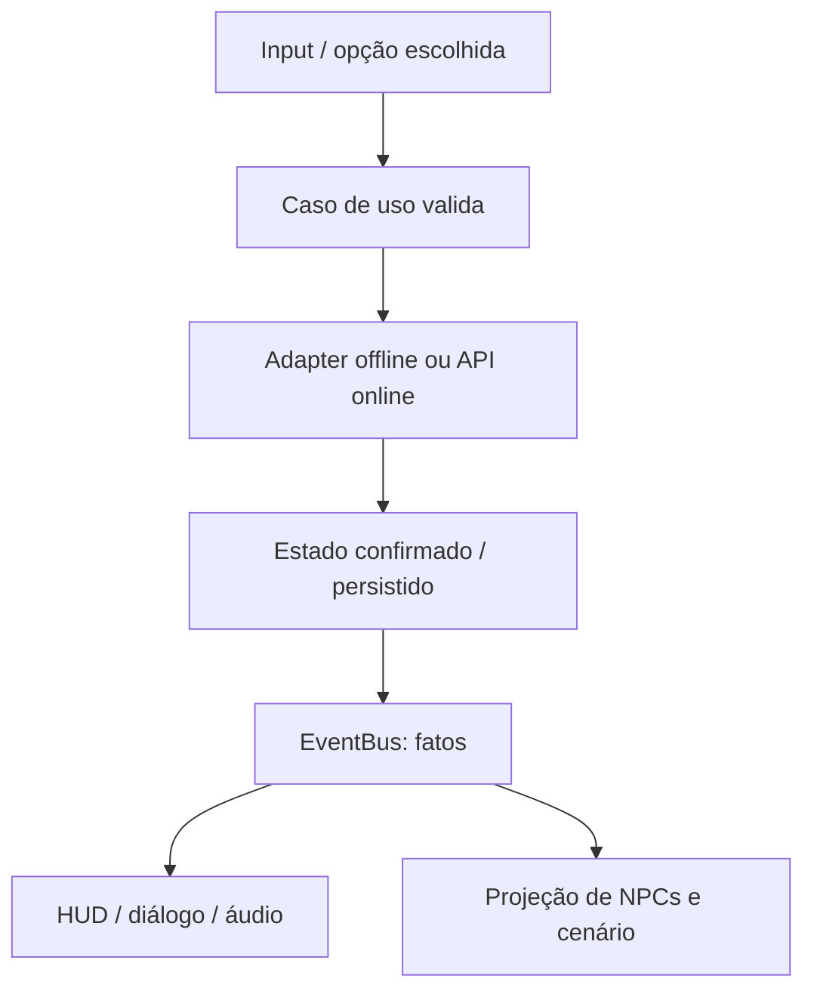

# Sprint 6 — Arquitetura de software e padrões Godot

**Projeto:** Echoes of Aethel · **Versão:** 1.0 · **Estado:** arquitetura de cliente revisada; exemplos não executados na engine.

## 1. Decisão de stack e escopo

Esta Sprint oficializa **Godot/GDScript como direção do cliente**, substituindo Flutter/Flame da Sprint 2 para implementação futura. FastAPI, PostgreSQL, contratos REST, autoridade online e deployment permanecem. Não haverá dois clientes de produção nesta etapa. Os módulos 1–5 mantêm conteúdo, matemática, loot e narrativa; referências a Flutter/Flame passam a ser histórico da proposta anterior.

Documentação de Godot 4.6 é a referência dos exemplos; a versão exata do editor/export templates deve ser fixada após o primeiro smoke test. Não existe `project.godot`, cenas ou jogo executável nesta entrega. Os quatro scripts anexados são preservados em [godot-original](../reference/godot-original/) como referência histórica, fora da futura raiz de runtime.

Player e NPC Core vieram no texto da mensagem, não como arquivos completos. O trecho NPC tem truncamento sintático e não é promovido a código funcional. Esta Sprint documenta o desenho e correções; não instala esses esboços como Autoloads de produção.

### 1.1 Revisão dos arquivos recebidos

| Arquivo / trecho | Achado | Diretriz |
|---|---|---|
| GameState.gd | `class_name` sem `extends Node`; dicionários em memória, sem gravação | Herdar Node; separar sessão, projeção e SaveRepository |
| GameState.gd | `%EventBus` aponta a nó de nome único, não ao Autoload; `crime_committed` recebe só um argumento, mas declara dois | Usar Autoload configurado e assinatura única; não inferir crime só de estado hostil |
| EventBus.gd | Falta `extends Node`; sinais do texto `dialogue_requested` e `player_stamina_changed` não existem | Declarar contrato e payloads antes dos consumidores |
| actor_base.gd | Não herda CharacterBody2D; `velocity` redeclarada, corpo genérico e colisão/morte comentados | Corpo real, vida por componente, morte idempotente e desativação deferida |
| actor_base.gd | Dano negativo poderia curar; init ignora mudanças posteriores de configuração | Recusar dano ≤0; inicialização validada antes da cena entrar em jogo |
| player.gd textual | `move_and_slide()` sem base física; normalizar input perde magnitude analógica; desaceleração sem delta | Corrigir herança, usar get_vector e separar métrica de projeção |
| npc_core.gd textual | Código quebrado e métodos de GameState incompatíveis; atributo `health` não existe | Unificar IDs/status e usar current_health; teste de parse futuro |
| dialogue_node.gd | Choice sem option_id e disponibilidade sempre true | Resource tipado, ID estável e requisitos fail-closed |

Não é uma arquitetura “perfeita” nem elimina todo acoplamento. Eventos removem referências desnecessárias, mas criam dependências em contratos e ordem de observação. Serviços explícitos e componentes pequenos são igualmente necessários.

## 2. Observer, comandos e eventos

`EventBus` notifica **fatos já confirmados**: ator morreu, escolha foi aplicada, zona mudou. Input/UI enviam comandos ao caso de uso; não publicam consequências arbitrárias no barramento para outro listener executar. Consulta de diálogo chama um resolver tipado, sem pedir uma resposta síncrona por sinal global.



| Comunicação | Mecanismo |
|---|---|
| Player → motor de movimento | Composição local/referência tipada |
| UI → escolher quest/equipar item | Serviço de aplicação e comando validado |
| Sistema → obter flags/diálogo | Consulta explícita de snapshot/resolver |
| Resultado → HUD, áudio, cenário | Evento confirmado via bus ou sinal local |
| Cliente → progressão online | REST da Sprint 2; identidade/versionamento/idempotência |

Contrato mínimo de EventBus, exemplo para futura integração:

```gdscript
extends Node
# Autoload: EventBus; não duplicar com class_name EventBus.
signal actor_damaged(actor_id: StringName, hp_damage: int, attacker_id: StringName)
signal actor_died(actor_id: StringName)
signal npc_state_changed(npc_id: StringName, state: StringName)
signal dialogue_requested(npc_id: StringName, dialogue_id: StringName)
signal quest_choice_applied(quest_id: StringName, option_id: StringName)
signal player_stamina_changed(current: float, maximum: float)
signal crime_committed(victim_id: StringName, crime_type: StringName)
signal zone_changed(zone_id: StringName)
```

Sinais locais podem carregar Node para interação transitória, mas eventos duráveis/rede usam IDs e `event_id`, não referência a objeto que será liberado. Adapter online deduplica event_id antes de emitir; bus não é fila persistente nem substitui transação. Não registrar duas vezes o mesmo listener ao trocar cena; verificar conexões e desmontar listeners de longa vida explicitamente. Evitar evento que reaplica o próprio comando em ciclo.

## 3. GameState e persistência

Autoload mantém a **sessão corrente e projeção observável**, não todo código de negócio. `world_flags`, `npc_states`, reputação e escolhas têm métodos controlados; nenhum script de arte modifica diretamente seus dicionários. Status único: `alive`, `dead`, `hostile`; `normal`, `vivo`, `morto` e `hostil` do esboço são migrados na leitura, não espalhados pelo código novo.

```gdscript
extends Node
# Autoload: GameState.
var npc_states: Dictionary = {}
var world_flags: Dictionary = {}
var faction_reputation: Dictionary = {}

func get_npc_state(npc_id: StringName) -> StringName:
    return StringName(npc_states.get(npc_id, &"alive"))

func set_npc_state(npc_id: StringName, next_state: StringName) -> bool:
    if npc_id == &"" or next_state not in [&"alive", &"dead", &"hostile"]:
        return false
    var previous := get_npc_state(npc_id)
    if previous == next_state or previous == &"dead":
        return false
    npc_states[npc_id] = next_state
    EventBus.npc_state_changed.emit(npc_id, next_state)
    return true
```

Trecho representa projeção em memória; não alegar persistência em disco por usar Singleton. Estado `dead` é terminal nessa campanha; restauração só ocorre por nova campanha ou operação de manutenção explicitamente autorizada. Atualizar projeção **depois** do commit offline/online. Reputação clamp −100…100; set de flag igual não emite de novo.

`SaveRepository` offline grava JSON versionado em `user://`, com arquivo temporário/backup, validação de tamanho/tipos/IDs e substituição recuperável. Não carregar recursos/scripts arbitrários do save. Autoload sobrevive à troca de cena, mas não ao fechamento do processo. Online, API/banco continuam autoridade e GameState é cache: alterações locais não concedem morte, crime, loot, XP ou escolhas definitivas.

Não confundir `npc_states` com spawn de monstro comum: NPC narrativo tem ID estável por campanha; monstro usa encounter/spawn ID. Respawn não ressuscita cidadão morto nem repete fragmento. NPC essencial da Cidadela não pode ser morto por interação física: zonas seguras bloqueiam dano antes da resolução.

## 4. ActorBase e componentes de entidade

Base física concreta mínima `ActorBase extends CharacterBody2D`; não declarar `velocity` novamente, pois vem da engine. “Abstrata” significa contrato de projeto aqui; não usar anotações de linguagem sem fixar versão compatível.

Compor `HealthComponent`, `CombatStats`, `MovementController`, `StatusEffects` e `AppearanceController`. ActorBase não calcula loot, salva quests ou desenha retratos; une referências da cena e aplica resultado validado. Personagens, criaturas e NPCs móveis podem reutilizá-la; objetos imóveis não precisam herdar CharacterBody2D apenas para ter vida.

```gdscript
class_name ActorBase
extends CharacterBody2D

@export var actor_id: StringName
@export var max_health: int = 100
@export var combat_enabled: bool = true
var current_health: int
var is_dead: bool = false
@onready var body_shape: CollisionShape2D = $CollisionShape2D

func _ready() -> void:
    current_health = maxi(1, max_health)

# Exemplo offline: recebe dano final já calculado pelo domínio.
func apply_validated_damage(amount: int, attacker_id: StringName) -> void:
    if is_dead or not combat_enabled or amount <= 0:
        return
    var actual := mini(amount, current_health)
    current_health -= actual
    if current_health == 0:
        is_dead = true
        velocity = Vector2.ZERO
        set_physics_process(false)
        body_shape.set_deferred("disabled", true)
    EventBus.actor_damaged.emit(actor_id, actual, attacker_id)
    if is_dead:
        EventBus.actor_died.emit(actor_id)
```

Cena exige filho CollisionShape2D configurado. Se houver hurtboxes/attack areas, desligá-las de forma deferida junto do corpo. O guard `is_dead` torna morte idempotente. Não usar esse método como endpoint que aceita dano do cliente online: ele só reflete resultado confirmado. Em produção, mover HP para HealthComponent evita duas fontes de verdade.

Subclasses que sobrescrevem `_ready()` precisam chamar `super._ready()` antes de usar HP/shape ou implementar inicialização por componente. Morte interrompe input/IA/ataques, preserva animação de cadáver quando necessário e só remove o nó depois que eventos/estado forem registrados. Criar CrimeSystem não permite matar NPC no hub; agressão externa precisa de conteúdo/autorização próprios.

## 5. Player — vetores, projeção e dash

### 5.1 Movimento

Direção canônica segue top-down 3/4. O perfil **2:1 é uma projeção opcional de experimento**, não muda toda a geometria por reduzir só `velocity.y`. Em métrica lógica, normalizar limita diagonal; projetar em 2:1 reduz distância vertical em pixels, portanto não mantém velocidade igual na métrica da tela. Mapas/colisões/câmera devem compartilhar a mesma transformação. Escolher política antes de produzir cenas finais.

`Input.get_vector` aplica deadzone e limita comprimento sem forçar analógico fraco a velocidade máxima. Exemplo:

```gdscript
var intent := Input.get_vector("move_left", "move_right", "move_up", "move_down")
var projected := Vector2(intent.x, intent.y * vertical_projection_scale)
velocity = projected * movement_speed
move_and_slide() # velocity em pixels/s; não multiplicar novamente por delta.
```

`vertical_projection_scale=1.0` no top-down canônico; `0.5` somente na cena de validação 2:1. Evitar desaceleração por quantidade fixa por frame: usar velocidade alvo direta ou `move_toward(target, acceleration*delta)`. Guardar último facing não zero; dash sem input usa facing, não força sempre para baixo.

### 5.2 Stamina e estados

Nova decisão desta Sprint: dash usa **stamina universal separada de MP e vigor**. Não é atributo distribuível. Substitui a esquiva gratuita de 0,25 s descrita no baseline; efeitos de invulnerabilidade ainda precisam de playtest.

| Parâmetro | Baseline |
|---|---|
| Estado | IDLE, MOVE, DASH; dead/paused bloqueiam transições |
| Velocidade normal / dash | 150 / 400 unidades lógicas/s |
| Dash | 0,2 s, custo 25 stamina, cooldown 1,2 s |
| Stamina máxima/inicial | 100 / 100 ao abrir expedição |
| Regeneração | 10/s fora do estado DASH; bloqueada em pausa/morte |
| Direção | Facing normalizado; projeção idêntica à caminhada |
| Invulnerabilidade | Não implícita pelo estado DASH; janela futura validada por domínio |

Debitar custo e iniciar timer/cooldown juntos; recurso insuficiente não inicia ação. Preservar saldo no reload do mesmo encontro, sem restaurar 100 gratuitamente. Emitir stamina_changed por mudança observável, não apenas no gasto. Vigor do Bastião mantém as regras da Sprint 5 e não paga dash.

```gdscript
# Fragmento do controller; timer, state e facing pertencem a ele.
func try_dash(direction: Vector2) -> bool:
    if is_dead or dash_cooldown_left > 0.0 or stamina < 25.0:
        return false
    dash_direction = direction.normalized() if direction != Vector2.ZERO else facing
    stamina -= 25.0
    dash_time_left = 0.2
    dash_cooldown_left = 1.2
    state = State.DASH
    EventBus.player_stamina_changed.emit(stamina, stamina_max)
    return true
```

Trecho não é player.gd completo. Integrar contagem temporal, limitação do último passo de dash (evitar duração extra dependente de tick), `move_and_slide`, morte, bloqueio de UI e collision tests. Input global precisa ser bloqueado enquanto menu/diálogo captura controle. No online, mandar intenção ao servidor; previsão local nunca permite atravessar parede ou acelerar stamina/cooldown pelo relógio do cliente.

## 6. NPC Core, agressão e crime

NPC Core compõe ActorBase, identidade narrativa, InteractionComponent e Brain/StateMachine. Antes de criar visual/interação, consulta status confirmado por `npc_id`: dead não spawna; hostile ativa IA; alive permite resolver diálogo.

Fluxo externo: dano válido de agressor identificado → CombatSystem resolve HP → CrimeSystem verifica facção/zona/contexto legítimo → caso de uso registra crime/reputação/hostilidade → evento confirmado atualiza NPCs/HUD. Não deduzir crime apenas porque alguém ficou hostil; defesa autorizada e monstros não são crimes automaticamente.

```gdscript
# Trecho de NPC Core, após inicialização e autorização de interação.
func interact() -> void:
    if is_dead or GameState.get_npc_state(npc_id) == &"hostile":
        return
    var dialogue_id := dialogue_resolver.resolve(npc_id, default_dialogue_id)
    if dialogue_id != &"":
        EventBus.dialogue_requested.emit(npc_id, dialogue_id)
```

Resolver é serviço explícito configurado na composição; não método inexistente adicionado informalmente ao GameState. Se agressão mata a vítima, estado dead prevalece sobre hostile; não ativar perseguição após morte. Hit repetido não aplica reputação repetidamente sem crime_id/action_id. NPC reage a dano dirigido ao próprio ID, não a qualquer sinal global.

Mudança de cor é só feedback, não a própria IA. Separar alvo conhecido, percepção, perseguição, antecipação e recuperação. Em hubs, combat_enabled=false e o domínio recusa ataque; Maera/Lyra/Bram/Irian e serviços essenciais respeitam Sprint 4. Sistema de crime externo é extensão planejada, não quest implementada por esta documentação.

## 7. DialogueNode — dados e escolhas

DialogueNode é `Resource` para autoria no editor; conteúdo externo pode ser JSON validado equivalente. Texto, requisitos, destino e efeitos são dados, sem física/sprite/Node no catálogo. Classes de dados em arquivos próprios tornam inspeção e validação mais simples.

```gdscript
class_name DialogueChoice
extends Resource

@export var option_id: StringName
@export var choice_text: String
@export var target_node_id: StringName
@export var requirements: Dictionary = {}
@export var effect_ids: Array[StringName] = []

func is_available(flags: Dictionary, reputation: Dictionary) -> bool:
    for key in requirements:
        if key not in ["flags", "min_reputation"]:
            return false
    var needed = requirements.get("flags", {})
    var minimums = requirements.get("min_reputation", {})
    if not (needed is Dictionary) or not (minimums is Dictionary):
        return false
    for flag in needed:
        if not flags.has(flag) or flags[flag] != needed[flag]:
            return false
    for faction in minimums:
        if not (minimums[faction] is int):
            return false
        var current = reputation.get(faction, 0)
        if not (current is int) or current < minimums[faction]:
            return false
    return true
```

```gdscript
class_name DialogueNode
extends Resource

@export var node_id: StringName
@export var text_lines: Array[String] = []
@export var choices: Array[DialogueChoice] = []
@export var is_moral_dilemma: bool = false
```

Requisitos desconhecidos são recusados; validador de catálogo verifica valores e referências antes do jogo. `flags` exige existência explícita, inclusive se o valor desejado é false. Reputação não cadastrada usa 0 somente se facção existir no catálogo. Efeitos têm IDs allowlisted, não instruções arbitrárias para escrever qualquer dicionário.

Para dilemas da campanha, validador exige exatamente duas opções e disponibilidade de ambas quando a quest abre; condições não podem esconder uma e romper a premissa. Falas ambientais/menus operacionais não precisam de duas opções. Requisitos podem selecionar variante de texto, sem apagar o custo de uma rota.

Escolher opção chama DialogueService/QuestService, que revalida estado atual, alvo/quest, versão e idempotência. O cliente não envia um Dictionary de consequências para o backend. Efeitos ocultos ficam em catálogo de servidor; recursos exportados no cliente contêm apenas conteúdo necessário à apresentação, reduzindo spoilers. Após commit, aplica projeção, emite quest_choice_applied e avança diálogo. Falha mantém nó/feedback e permite retry do mesmo comando.

## 8. Pastas e README estrutural

Futura raiz do projeto Godot: `client/godot/`; portanto `res://core/` corresponde a `client/godot/core/`. Não mover GDD da raiz do repositório para res://. O README principal continua apresentação oficial; README técnico dentro do cliente será criado com o projeto executável.

| Caminho futuro | Conteúdo permitido |
|---|---|
| `client/godot/core/` | EventBus, GameState, composição/bootstrap, config, adapters de save/API |
| `client/godot/entities/` | ActorBase, player, NPCs, inimigos e componentes de saúde/movimento |
| `client/godot/systems/` | Combate, inventário, quests, crime, resolver e serviços de diálogo |
| `client/godot/assets/` | Sprites, tiles, retratos, áudio e metadados; sem regra de combate |
| `client/godot/ui/` | HUD, FCT, caixas e menus Control/CanvasLayer |
| `client/godot/scenes/` | Mapas e composição de nós; cena principal e factories |
| `content/` | Fonte de catálogo versionada e validada; split de dados públicos/ocultos |
| `backend/` | FastAPI, domínio autoritativo, SQLAlchemy e Alembic |
| `infra/` | Compose, proxy, backups e documentação operacional |
| `tests/` | Vetores compartilhados, testes de conteúdo/domínio e integração |
| `docs/reference/godot-original/` | Esboços recebidos, preservados sem executar como runtime |

Configurar Autoload EventBus antes de GameState; manter nomes do Autoload distintos de class_name se usar ambos. Scenes de atores exigem CharacterBody2D, CollisionShape2D, visual paperdoll e componentes configurados. Input Map: move_left/right/up/down, dash, interact, potion_hp, potion_mp e habilidades. Godot renderer/UI substituem Flame/Flutter, mas IDs, matemática inteira e API não mudam de autoridade.

No web, proxy serve export Godot e mantém fallback/routing compatível com export real. Se usar export com threads/SharedArrayBuffer, validar headers de isolamento e todas as dependências antes de habilitar; não presumir que build Flutter e Godot possuem os mesmos arquivos. Novo pipeline de build/export e compatibilidade de browser precisam de teste.

## 9. Critérios de aceite futuros

1. Projeto abre com versão fixada, scripts parseiam e Autoloads não têm símbolos/signals ausentes.
2. Morte emite uma vez, recusa dano negativo, cancela controle e desliga colisões de forma segura.
3. Diagonais/analógico e dash passam testes de métrica, timer, paredes, cooldown e stamina.
4. Estado de NPC morto não retorna no reload; hostility não sobrescreve morte; crime legítimo é distinto de combate comum.
5. Requisitos desconhecidos negam opção; dilemas continuam com duas rotas disponíveis.
6. Escolha/recompensa se persistem antes de notificar; retry/reload não duplicam efeitos ou FCT.
7. Online não aceita HP/loot/crime/consequências arbitrárias do cliente; input/previsão reconciliam com servidor.
8. Hubs bloqueiam dano e preservam NPCs/serviços essenciais.
9. Save local versionado recupera backup; fechamento do processo não é confundido com troca de cena.

Sem afirmar testes de engine nesta Sprint. Primeiro próximo marco técnico: criar project.godot e cena mínima offline com ator, parede, dash, HUD e diálogo; depois persistência/quest, antes de API e deploy.

## 10. Referências oficiais

Consultadas em 13/10/2026; trechos são adaptações de projeto, não transcrições da documentação.

- [Godot 4.6 — Autoload](https://docs.godotengine.org/en/4.6/tutorials/scripting/singletons_autoload.html)
- [Godot 4.6 — Input](https://docs.godotengine.org/en/4.6/classes/class_input.html)
- [Godot 4.6 — CharacterBody2D](https://docs.godotengine.org/en/4.6/classes/class_characterbody2d.html)
- [Godot 4.6 — colisões deferidas](https://docs.godotengine.org/en/4.6/getting_started/first_2d_game/03.coding_the_player.html)
