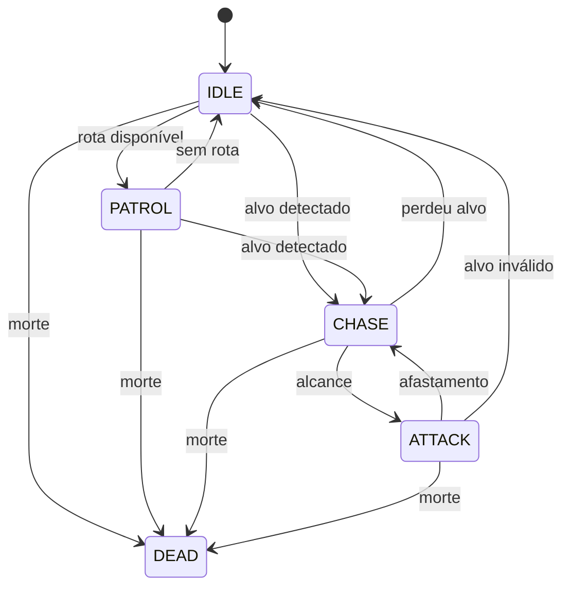

# Sprint 9 — FSM de inimigos e NPCs hostis

> **Escopo técnico histórico:** APIs, sprites, pixels e projeção 2D desta página descrevem propostas/clientes anteriores. Para Unity, seguir [transição](../engineering/unity-transition.md) e [direção visual 3D](../design/unity-art-direction.md); portar contratos, sem copiar stack, unidades ou APIs de renderização.

**Estado:** núcleo offline implementado/testado em Godot 4.6. Ainda não há campanha jogável, CrimeService completo, pathfinding ou loot implementado.

## 1. Arquivos e composição

| Arquivo | Responsabilidade |
|---|---|
| [enemy_fsm.gd](../../client/godot/entities/ai/enemy_fsm.gd) | Cinco estados, percepção, patrulha, perseguição e antecipação |
| [actor_base.gd](../../client/godot/entities/actor_base.gd) | Corpo, movimento físico, dano/morte offline e projeção de cadáver |
| [event_bus.gd](../../client/godot/core/event_bus.gd) | Eventos de dano, morte e crime confirmado |
| [test_enemy_fsm.gd](../../client/godot/tests/test_enemy_fsm.gd) | Integração de percepção, combate, paredes, hub e persistência |

`res://entities/ai/enemy_fsm.gd` corresponde ao arquivo sob `client/godot`. Cena deve ter ActorBase/CharacterBody2D com actor_id único, CollisionShape2D e EnemyFSM filho. ActorBase é o único responsável por move_and_slide; FSM escreve velocity, sem mover o corpo novamente.

## 2. Estados

| Estado | Entrada / ação | Saída |
|---|---|---|
| IDLE | Velocity zero; procura candidato em intervalo de 200 ms | Alvo válido → CHASE; waypoints → PATROL |
| PATROL | Percorre waypoints em coordenadas globais | Alvo adquirido → CHASE; sem rota → IDLE |
| CHASE | Persegue alvo vivo da mesma zona com linha de visão | Alcance → ATTACK; alvo morto/inválido/longe/oculto → IDLE |
| ATTACK | Para; antecipa golpe, executa e recupera | Fora de alcance → CHASE; alvo inválido → IDLE |
| DEAD | Velocity zero, cancela alvo/windup e processamento | Terminal para essa instância |



Fuga não integra estes cinco estados; comportamento de fuga exige extensão deliberada. DEAD não calcula nem sorteia loot. ActorBase emite actor_died uma vez; RewardService futuro deve resolver recompensa identificada por encontro/spawn, conforme Sprint 3. Restaurar cadáver não emite morte novamente.

## 3. Percepção e movimento

Area2D circular criada pelo componente acompanha o ator. Layer do detector=0, mask=1; atores detectáveis usam layer 1. Paredes usam layer 2, mask de raycast=2 por padrão. Candidatos entram/saem via sinais; aquisição escolhe o hostil mais próximo com linha de visão, sem varrer toda a cena a cada frame.

Raycast continua necessário: Area2D não distingue uma pessoa atrás de uma parede. Aquisição usa consultas a cada 200 ms, perseguição/execução conferem visibilidade do alvo relevante. Não é custo zero nem benchmark de escalabilidade; otimização de muitos agentes requer perfil real.

Perda além de 1,5× detection_range, morte, liberação do Node ou mudança de zona cancela alvo e zera velocity. Patrulha usa waypoints globais explícitos, sem deslocar âncora junto com o ator. Não há navegação ao redor de paredes: perde linha de visão e retorna ao repouso/patrulha. NavigationAgent2D fica para bloco posterior.

Perfil canônico top-down usa vertical_projection_scale=1.0. Valor 0.5 permite experimentar projeção 2:1, com limitações de métrica descritas no módulo 06; não mudar só a velocidade e afirmar isometria completa. O corpo físico não multiplica velocity por delta antes de move_and_slide.

## 4. Ataque com antecipação

Baseline do harness: alcance 40, windup 0,4 s, recuperação/cooldown 1,5 s, dano final fixo 15. Valores são parâmetros de teste, não balanceamento do catálogo.

Entrada de ATTACK não causa dano instantâneo. Subestado interno prepara alvo e emite attack_telegraphed; conclusão valida novamente alvo, zona, vida, alcance e parede. Alvo que se afasta durante windup evita o dano. O alvo fica identificado para o golpe, mas o protótipo de ataque corpo a corpo ainda acompanha sua posição para teste de alcance; golpes direcionais/projéteis exigirão geometria e orientação travadas pelo CombatService.

O método take_damage do harness resolve HP e emite actor_damaged **uma vez**. A FSM não emite outro evento de dano depois da chamada. Em morte, cancela física e CollisionShape2D de forma deferida. Dano negativo/zero, morte prévia, atacante inválido ou zona segura são recusados. Barreira/DEF/MDEF/MP/crítico da Sprint 5 ainda não entram nesse método: integração com CombatService é necessária antes do jogo real.

## 5. Crime e NPC neutro

Um victim_id isolado não identifica quem atacar nem onde ocorreu o crime. O contrato executável usa `crime_committed(event: Dictionary)` com:

| Campo | Significado |
|---|---|
| crime_id | ID estável do crime confirmado |
| victim_id | Identidade da vítima |
| attacker_id | Identidade do agressor |
| zone_id | Zona do evento |
| position | Vector2 da ocorrência local |

Esse Vector2 é payload interno Godot, não DTO JSON de rede; adapter de rede deve validar e converter posições. CrimeService futuro confirma contexto/facção/autoria antes de emitir. Não emitir crime automaticamente para todo dano em monstro, defesa autorizada ou NPC simplesmente hostil.

NPC testemunha precisa ser narrative_npc, vivo, combat_enabled, na mesma zona, próximo ao evento e capaz de identificar agressor entre candidatos com linha de visão. Autoria própria e crimes remotos são ignorados. Persistir npc_states[id]=hostile com SaveSystem antes de CHASE; falha de gravação não confirma hostilidade. O alvo correto é o agressor, não a vítima.

Cache local de 128 crime_ids evita repetição imediata; não é auditoria durável de crime nem atualização de reputação. CrimeService terá deduplicação persistente e regras de reputação próprias. NPC já morto no save não vira hostil. Morte de NPC narrativo é gravada antes de aplicar o golpe letal; falha retorna false sem morte parcial. Monstro comum não escreve npc_states, pois respawn depende de spawn/encontro.

Ao restaurar mundo, hostile reativa agressividade e dead restaura corpo sem evento de loot. Se carregar estado anterior que requer recriar NPC já removido/morto, SceneService deve reconstruir a cena; FSM terminal não ressuscita a própria instância. A implementação não inclui npc_core/DialogueResolver completo.

## 6. Hub e autoridade

Configurar combat_enabled=false em atores da Cidadela; FSM não persegue/ataca e ActorBase recusa dano. Domínio de produção também deve validar safe zone, não depender apenas do campo visual do cliente. Não há crime nem ataques contra Bram/Lyra/Irian/Maera dentro do hub.

Tudo neste harness é **offline**. Cliente não pode usar take_damage ou emitir crime local como prova de resultado online. FastAPI deverá simular/validar intenção, vida, cooldown e recompensa; cliente recebe fatos confirmados e projeta estado. Save local com hash não autentica combate ou crime.

## 7. Validação e limites

```bash
godot --headless --editor --path client/godot --quit
godot --headless --path client/godot --script res://tests/test_enemy_fsm.gd
godot --headless --path client/godot --script res://tests/test_save_system.gd
```

Executados em Godot 4.6 Linux headless: **25 verificações FSM e 27 de save, zero falhas**. Cobertura: Area2D real, windup/cooldown, afastamento, alvo perdido/morto, patrulha, parede, hub, dano negativo, morte idempotente, crime remoto/autoria, hostilidade persistida e cadáver sem nova morte. Não foram medidos FPS/carga, rede, navmesh ou exports mobile/web.

Harness usa diretório de userdata próprio do projeto de teste; testes limpam saves desse harness. Não apontar para saves de produção e não executar suítes simultâneas sobre o mesmo slot.

Próximos passos: CrimeService e CombatService explícitos, RewardService idempotente, pathfinding, animações e cena de playtest. A FSM já é código executável de núcleo, sem afirmar que esses sistemas estejam integrados.
